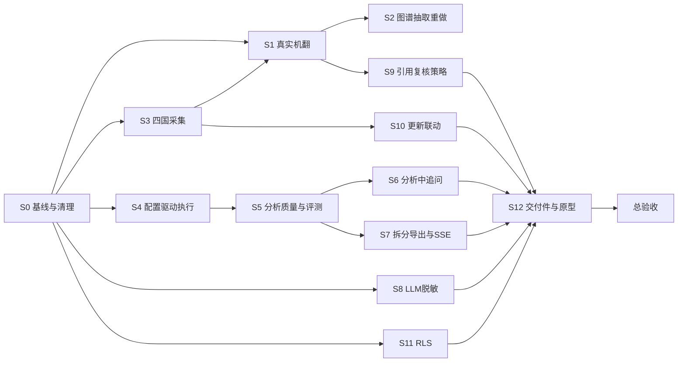

# 车研数合:P1/P2/P3 整改工作计划(交给执行方大模型逐步完成)

> [!IMPORTANT]
> 本文件是给**执行方大模型**的指令书。每一步都有:目标 → 要做什么 → 做成什么样(验收形态)→ 技术 → 怎么验证 → 依赖。
> 一次只做一步,验证通过并提交后再进入下一步。标「👤」的是必须由人决定或提供的事项,遇到就停下来问,不要自己假设。

## 0. 背景与已核实的问题(执行前必读)

仓库:`e:\汽研项目\CrossBorderPlatform`(Python 3.12 FastAPI + Vue3/TS pnpm workspace + PostgreSQL)。
需求依据:`e:\汽研项目\20261022会议记录.txt`、`会议记录2.txt`、`任务一 需求文档.docx`、设计文档 `docs/` 与 `new_platform_design.md`。冲突以会议纪要为准。

核查得到的 13 个问题(编号后文引用):

| # | 问题 | 本计划对应步骤 |
|---|---|---|
| 1 | 573 条"译文"全是本地术语表引擎产物(`engine=glossary_assisted`),英文只在原文里插术语,阿语译文与原文完全相同,没有真正翻译 | S1 |
| 2 | 图谱 1236 条边全是关键词规则抽取(`kg-rule-extractor-v1`),大量错配(如《Courts Reform Act》→个人数据出境限制);义务/罚则/数据类型是固定通用节点而非抽取实体;校验只查引文子串,不查语义 | S2 |
| 3 | 四国只有一期迁移种子(EG1/LB1/MA3/TN2 份文档,SG 43 份),四国站点停用且条款待确认;LB 127 条条款 120 条未挂图谱;会议提到新加坡约 80 余条 | S3 |
| 4 | 管理端 Agent 画布配置没有驱动真实执行(`pipeline.py` 写死,不读已保存的工作流配置);"导入配置"不改变行为 | S4 |
| 5 | 12/12 次任务首轮核验都失败并退回,重试一次后仍有缺口则成"部分样稿"(7/13),结果不稳定 | S5 |
| 6 | 评测集只是"前 5 候选出现关键词",人工复核 0/10,不能代表事实一致性等量化指标 | S5 |
| 7 | 只有整份导出,没有按维度拆分导出 | S7 |
| 8 | 分析过程中不会向用户追问(追问只在分析开始前) | S6 |
| 9 | 实时进度是 2 秒轮询,设计是 SSE | S7 |
| 10 | 调用大模型前没有脱敏 | S8 |
| 11 | 报告引用机翻未复核内容,与设计"只有已复核才作法律依据"不一致 | S9 |
| 12 | 更新联动只在出报告时检查,没有定时监测与推送 | S10 |
| 13 | 没有 PostgreSQL 行级安全(RLS) | S11 |
| 14 | 没有公开原型、没有产品说明书、没有开源许可声明页、字体未自托管;库里有 E2E 测试数据与 `ZZ 演示数据` 站点 | S0、S12 |

## 1. 执行规程(每一步都必须遵守)

1. **一步一提交**:每步结束 `git add -A && git commit -m "<type>(<scope>): ..."`,commit 信息写明步骤编号(如 `feat(S1): ...`)。不要把多步混在一个提交里。
2. **先读后写**:动手前先读这一步涉及的现有文件,别凭印象改。
3. **验证必须真跑**:每步"怎么验证"里的命令都要运行,并在最终回复里贴出关键输出。验证没过不得进入下一步,也不得把断言改宽来蒙混。
4. **不泄露密钥**:大模型 key 只能走环境变量 `CYSH_LLM_API_KEY`,不得写入任何被 git 跟踪的文件、日志或测试快照。
5. **许可证**:新增依赖必须是 MIT/BSD/Apache/ISC/PSF 等可商用许可;禁止 AGPL/GPL/SSPL 类(见 `docs/compliance/LICENSE_POLICY.md`),并登记 `docs/compliance/THIRD_PARTY.md`,再跑 `scripts/check_licenses.py`。
6. **不确定就停**:遇到 👤 项、需求冲突或数据口径不明,停止并向用户提问,不要自行假设。
7. **不删数据**:涉及删除/重置数据库记录的操作,必须先导出备份并向用户确认。
8. **保持现有回归**:任何一步结束时 `pytest -q`、`ruff check app tests`、`pnpm typecheck`、`scripts/verify_ui_clickthrough.py` 都必须仍然通过(基线:176 项测试通过)。

### 环境速查(Windows PowerShell)

```powershell
# 后端依赖/测试(必须设置虚拟环境目录)
cd e:\汽研项目\CrossBorderPlatform\backend
$env:UV_PROJECT_ENVIRONMENT="C:\Users\Jin\.venvs\cyshuhe"
uv run --python 3.12 pytest -q
uv run --python 3.12 ruff check app tests

# 本地起服务(后端 8000;改代码后需重启;用户端 5173,管理端 5174)
$env:CYSH_LLM_API_KEY="<由用户在终端设置,不要写进文件>"; $env:CYSH_LLM_MODEL="deepseek-flash"
uv run --python 3.12 python ..\scripts\dev_local.py --allow-fake-ip
cd ..; pnpm dev:user ; pnpm dev:admin

# 前端类型检查
pnpm typecheck

# 真实 Chrome 端到端手点验证(会真调大模型,约 3 分钟)
cd backend; $env:PYTHONIOENCODING="utf-8"
uv run --python 3.12 python ..\scripts\verify_ui_clickthrough.py
```

- 开发库在 `~\.cyshuhe-dev\pg`,原文归档在 `~\.cyshuhe-dev\archive`,账号密码在 `~\.cyshuhe-dev\credentials.json`(`admin@` / `member@` / `org-admin@` / `reviewer@example.com`)。
- API 前缀:`/api/auth`、`/api/admin/{sites,documents,knowledge,agent-studio}`、`/api/knowledge`、`/api/analysis`。管理端登录接口 `/api/auth/admin/login`。
- 读取中文文件用 `Get-Content -Encoding UTF8`(PowerShell 5 默认按 ANSI 读会出乱码,这不是代码问题)。
- 数据库结构变更必须写 Alembic 迁移(`backend/migrations/versions/`,接 `0008` 之后),并保证 `tests/test_migrations.py` 通过。

## 2. 总览与依赖



建议顺序:**S0 → S3 → S1 → S2 → S4 → S5 → S6 → S7 → S8 → S9 → S10 → S11 → S12 → S13**。S3 先于 S1 是因为四国原文入库后才能一起翻译抽取。

---

## S0 基线审计脚本与环境清理

**目标**:建立可重复的"数据与质量基线",后面每步都用它对比;清掉测试垃圾。

**做什么**
1. 新建 `scripts/audit_platform.py`:登录管理端接口,统计并打印/输出 JSON:
   - 各国站点数、启用数、条款确认状态、最近运行状态;
   - 各国文档数、版本数、条款数;
   - 译文:按国家的 `engine`、`model_name`、`review_status` 分布;**CJK 字符占比 ≥30% 的译文比例**;**译文与原文完全相同的数量**;
   - 图谱:按国家的节点类型数、关系类型数、`review_status` 分布、`extractor_model` 分布、未挂图谱条款数;
   - 分析任务:状态分布、`backtrack_count` 分布、`partial_sample` 比例。
   - 附带 `--json out.json` 输出,便于前后对比。
2. `.gitignore` 增加 `backend/data/`(pytest 产物)。
3. 开发库清理:删除 `ZZ 演示数据` 站点及其运行记录;删除 E2E 产生的测试对话(组织为"演示车企"、标题含 `CYS-Pilot`)。**删除前先导出备份并向用户确认(规程 7)**。
4. `conftest.py` 确认测试不写入 `backend/data`(改用 `tmp_path`)。

**做成什么样**:`python scripts/audit_platform.py` 一条命令输出人类可读报告 + JSON;保存首份基线到 `docs/architecture/baseline_2026-10-22.json`。

**技术**:`httpx` 调现有 API;不要直连数据库。

**验证**
- 运行脚本,输出中能看到本计划第 0 节的数字(译文 `glossary_assisted` 573、边 1236 等)。
- `git status` 在跑完 `pytest` 后不出现 `backend/data/`。
- `pytest -q` 全绿。

---

## S3 四国法规采集补齐(先于翻译)

**目标**:五国原文全部经新平台流水线入库(发现→下载哈希归档→解析/OCR→待复核),每份文档来源可追溯。

**做什么**
1. 梳理 `data/seed/source_sites.json` 与 `AutoDataCross/docs/phase2/data/current` 的一期数据,为埃及、突尼斯、摩洛哥、黎巴嫩各列出"官方入口 + 文档类型 + 语言 + 预计文件清单";埃及先核实正式官方入口(一期资料说尚无正式原文)。
2. 对账新加坡数量:一期记录"约 80 余条",新平台 43 份文档。查清口径(是文件数还是条款/条目数),差异写入 `docs/architecture/SG_COUNT_RECONCILIATION.md`;如缺文件则补抓。
3. 👤 **来源条款确认**:四国站点 `terms_status=pending` 须法务确认才可启用。开发环境可在界面里用"确认条款"并写明备注 `开发环境临时确认,待法务复核`;**正式环境不得由执行方自行确认**。
4. 用管理端"立即抓取"触发各站点;处理失败(网络错误、反爬、编码),把失败原因写进 run 记录并重试;扫描件走现有 Tesseract OCR(阿语/法语语言包),OCR 条款打 `ocr_required`/`needs_review` 标记。
5. 过滤无关文档:新增文档相关性判断(见 S2 的"文件级相关性"),先在采集阶段记录 `relevance` 字段,供 S2 使用;不要在此步删除文档。

**做成什么样**
- 每国至少:埃及 ≥ 3、突尼斯 ≥ 3、摩洛哥 ≥ 4、黎巴嫩 ≥ 2 份官方原文(来源 URL、获取时间、内容哈希、语言、版本齐全);数量目标若与事实不符,以实际官方可得为准并在文档里说明理由。
- 所有版本都到达"待复核"状态,失败项有明确原因。

**技术**:现有 `app/sources`(调度)、`app/ingestion`(fetcher、parser、OCR);不得绕过 robots/限速/来源条款闸门。

**验证**
- `scripts/audit_platform.py` 显示各国文档/条款数达标;抽 3 份文档检查归档文件存在且 SHA-256 与记录一致。
- `GET /api/admin/documents` 中每份文档 `latest_version` 非空且含 `content_hash`。
- 新增/保留 `tests/test_scheduler.py`、`test_ocr.py` 通过。
- 👤 提交条款确认清单给用户。

---

## S1 真实大模型机器翻译(问题 1)

**目标**:每条条款有真正的简体中文译文;译文保留条号、数字、金额、日期;术语使用术语库规定译法;无法翻译时明确标记失败,**不得把原文冒充译文**。

**做什么**
1. 阅读 `backend/app/knowledge/translator.py`、`glossary` 相关模型、`/api/admin/knowledge/translations*` 路由。
2. 重写翻译主路径(保留旧引擎仅作术语命中统计,不再产出 `translated_text`):
   - 分块:长条款按句/款拆分,每块 ≤ 约 1500 字符,保持顺序合并;
   - 提示词(新版本号 `translate-v2`):系统提示写明"法律翻译、逐句忠实、不增不减、保留条号与数字、术语表强制";将命中的术语表条目(原词→规定译法→法定定义)随块传入;
   - 调用 OpenAI 兼容接口(沿用 `settings.llm_*`);并发用 `asyncio.Semaphore`(默认 4)限流,带指数退避重试;
   - 译后程序检查(任一失败则重译一次,仍失败标 `failed` 并记录原因):
     ① CJK 占比 ≥ 30%(阿语/法语/英文原文都应翻成中文);
     ② 原文中的数字、金额、百分比、年份、条号在译文中全部出现;
     ③ 术语表要求的译法出现;
     ④ 译文不等于原文。
3. 状态机:新增/调整 `clause_translation.status`:`machine_translated`(通过检查)/`translation_failed`/`pending_review`/`approved`/`rejected`。LLM 不可用时**不产出假译文**,标 `not_translated`,界面显示"未翻译"。
4. 记录 `engine=llm`、`model_name`、`prompt_version`、`tokens_in/out`、`duration_ms`,用于成本核算。
5. 批量任务:`python -m app.cli translate --country SG --only-missing --concurrency 4` + 管理端"按文档批量翻译"按钮沿用现有接口 `POST /api/admin/knowledge/documents/{id}/translate`;已有的旧 `glossary_assisted` 记录**全部作废重译**(保留历史行并标 `superseded`)。
6. 用户端引用抽屉与法规知识库页:展示"中文译文(机器翻译,待核对)"+原文对照;未翻译时显示"暂无中文译文"。

**做成什么样**
- 五国所有条款译文 CJK 占比达标;译文与原文相同的数量为 0;失败率 ≤ 2% 且每个失败有原因。
- 前端不再把原文显示为"中文对照"。

**技术**:`httpx`/现有 LLM 适配层;Alembic 迁移新增字段;pytest 用假的 LLM 服务(monkeypatch `_call_llm_translate`)。

**验证**
- 单元测试:假 LLM 返回合格译文→通过;返回原文/漏数字/漏术语→重译→仍失败标 `translation_failed`;LLM 不可用→`not_translated` 且 `translated_text` 为空。
- `scripts/audit_platform.py`:`identical_to_original == 0`、CJK 达标率 ≥ 98%、`engine` 全为 `llm`。
- 人工抽检 10 条(五国各 2 条)把原文与译文对照贴在回复里。
- 管理端 `/api/admin/knowledge/translations` 抽查返回字段;前端截图一张。

---

## S2 知识图谱抽取重做(问题 2)

**目标**:六要素节点是**从条款中抽取的真实实体**,十二类关系的每条语义边都有"证据条款 + 证据原文片段 + 抽取模型 + 置信度 + 复核状态",且证据能真正支撑该关系。结构边(发布/监管/包含)与语义边分层统计。

**做什么**
1. 阅读 `backend/app/knowledge/extractor.py`、图谱模型与 `/api/admin/knowledge/graph`、`/extract`。
2. **文件级相关性**:新增一次大模型分类(`relevant`/`irrelevant` + 理由),判断文件是否与"智能网联汽车数据、个人数据、跨境传输、自动驾驶测试准入"相关;不相关的文件(如 Courts Reform Act)不进入语义抽取,只保留在文档库并打 `out_of_scope` 标记。
3. **条款级结构化抽取**(替换关键词规则):
   - 对每条与相关文件的条款,用大模型按固定 JSON Schema 输出实体与关系:
     `entities[{type, name_zh, name_orig, definition}]`、`relations[{type, source, target, evidence_quote, confidence}]`;
   - 关系类型取枚举:发布、修订、废止、约束、禁止、强制要求、豁免、监管、处罚、适用场景、数据出境限制、准入要求;
   - **类型约束矩阵**:每种关系只允许特定的源/目标节点类型组合(如 PROHIBITS 必须是 REGULATOR/INSTRUMENT → OBLIGATION/DATA_CATEGORY,AMENDS 只能 INSTRUMENT→INSTRUMENT 且证据中必须出现"修订/amend"类语义),违反则丢弃;
   - `evidence_quote` 必须是该条款原文的**逐字子串**(程序校验),不是则丢弃。
4. **语义裁判**(第二次大模型调用,不同提示词):输入"关系 + 证据片段",输出 `supports: yes/no/partial` + 理由;`no` 丢弃,`partial` 置信度降级并标记;只有 `yes` 才入图谱,默认状态 `pending_review`。
5. 节点去重与归一:同一实体(如"个人数据")跨条款合并,保留所有证据;义务/罚则节点来自抽取而不是固定模板。
6. 统计与展示:`quality_summary` 增加 `structural_edges` 与 `semantic_edges` 分开计数、`semantic_unjudged`、`low_confidence`;管理端质量体检条同步;用户端合规地图只展示 `approved` 与"待核对"明确标注的边。
7. 旧边处理:旧 `kg-rule-extractor-v1` 的边标 `superseded` 并从图谱视图隐藏(不物理删除)。

**做成什么样**
- 已知错配边(Courts Reform Act→个人数据出境限制、AMENDS 的"生效日期"证据等)消失;
- 每条语义边点开能看到证据原文且逐字匹配,抽检语义吻合;
- 图谱页出现抽取出的多种义务/罚则/数据类型节点,而非 5 个固定节点。

**技术**:现有 LLM 适配层 + Pydantic 校验 JSON Schema;`rapidfuzz`(MIT)可选用于子串对齐;Alembic 迁移(边加 `confidence`、`judge_verdict`、`superseded`)。

**验证**
- 单元测试:类型约束、子串校验、裁判 `no` 丢弃、`out_of_scope` 不抽取。
- **金标集**:在 `backend/tests/fixtures/kg_gold.json` 放 ≥ 60 条人工判定的"关系 + 证据 + 正确/错误"样例(执行方先从库里按每种关系抽 5 条整理初稿;👤 请用户或律所抽检确认)。要求:错误样例被拒绝率 ≥ 90%,正确样例通过率 ≥ 80%。
- `audit_platform.py`:`extractor_model` 不再出现 `kg-rule-extractor-v1`(除 superseded);语义边与结构边分开列出;`quote_mismatch == 0`。
- 前端截图:管理端图谱页、用户端合规地图。

---

## S4 让管理端 Agent 配置真正驱动执行(问题 4)

**目标**:管理端保存/导入的工作流版本就是实际执行的版本;改配置会改变行为,并且每次运行记录"用了哪个版本"。仍保持只读界面,不允许在线改代码。

**做什么**
1. 阅读 `app/analysis/workflow_engine.py`、`pipeline.py`、`router.py` 里的工作流版本接口。
2. 定义**可配置参数白名单**(Pydantic 模型):每个节点允许调整 `enabled`(部分节点)、`model`、`temperature`、`system_prompt`、`top_k`、`max_backtrack_rounds`、`timeout`;**代码入口 `code_entrypoint`、MCP 工具绑定、节点拓扑不可经导入修改**。
3. `pipeline.py` 启动时读取"当前激活版本",按配置构造各 Agent 调用参数;提示词从配置读取(代码里保留默认值作为首个版本)。
4. 导入流程:校验 → 生成新版本(不自动激活)→ 管理员在界面点"激活"(新增 `POST /workflow/versions/{id}/activate`)→ 可回滚到旧版本。
5. 每个 `AnalysisStepTrace` 与 `AnalysisTask` 记录 `workflow_version_id`;管理端轨迹里显示该版本号。
6. 画布显示的提示词/参数必须就是执行用的同一份数据。

**做成什么样**:导入一份修改了 `top_k`/`system_prompt` 的 DSL → 激活 → 新建一次分析,管理端运行轨迹里能看到使用了新参数与新版本号;非法修改(改代码入口)被拒绝。

**技术**:FastAPI + Pydantic 校验;Alembic 迁移新增 `workflow_version_id` 字段;前端 `AgentStudio.vue` 增加"激活/回滚"按钮,保持参数只读。

**验证**
- pytest:导入合法配置→激活→调用流水线时拿到的参数等于配置值(用假 LLM 断言请求体里的 `temperature`/prompt);导入含 `code_entrypoint` 修改→400。
- 手点验证脚本新增:导入、激活、回滚按钮点击无错误。
- 对比同一输入前后两次任务的 `workflow_version_id` 不同。

---

## S5 分析质量与真实评测(问题 5、6)

**目标**:首轮核验失败率大幅下降,同输入多次运行结果稳定;有一套能反映检索召回、引用忠实度、事实一致性的评测。

**做什么**
1. **先诊断**:写 `scripts/analyze_backtracks.py`,读取最近任务的 `verification` 轨迹,把首轮失败按原因分类(引文不是子串、数字不一致、引用了检索外条款、条号不存在),输出占比表。**先把结果贴给用户**再改。
2. **从根上消除子串失败**:改为"模型只选择 `clause_id` + 句子编号",由系统从原文中按句编号**程序化截取逐字引文**,模型不再自己抄引文;分析提示词里给出带句子编号的条款。
3. 退回策略:最多 2 轮;每轮把具体问题与对应原文塞回提示词;仍无依据的维度输出"证据缺口"而不是编造。`partial_sample` 只能因为"缺少可用法源"产生,不能因为大模型格式问题产生。
4. 稳定性:分析调用 `temperature=0`(受 S4 配置),输出 JSON 解析失败重试;记录失败原因。
5. **评测集扩充**到 ≥ 30 题(覆盖五国与八个维度),每题含:场景事实、期望命中的条款(`document_title` + `clause_number`)、期望结论要点。新增 `scripts/eval_p3.py` 输出:
   - 检索 recall@5(命中期望条款);
   - **引文忠实度**:引文逐字子串 + 数字一致(程序判);
   - **事实一致性**:另一次大模型调用,输入"结论 + 引文",判断结论是否被引文支持(LLM-as-judge,标注 `llm_judged`);
   - 结果 JSON + `docs/architecture/eval_report_YYYYMMDD.md`;人工复核栏留空,标注"未经人工复核"。
6. 管理端评测看板展示真实指标,并把"人工复核 0/N"如实显示。

**做成什么样**:同一输入连续 10 次运行,首轮核验失败率 ≤ 30%(基线约 100%),`partial_sample` 仅在确实缺法源时出现;评测报告三项指标有数字。

**技术**:现有 `pipeline.py`、`tools.py`;`scripts/eval_p3.py` 用 `httpx` 调接口;JSON Schema 校验。

**验证**
- `scripts/analyze_backtracks.py` 前后对比表(改造前基线 vs 改造后)。
- 同输入 10 次运行统计:`backtrack_count` 分布、`partial_sample` 比例,贴表。
- `eval_p3.py` 跑完输出三项指标;`pytest tests/test_analysis_p3.py` 全绿。
- E2E 手点脚本通过。

---

## S6 分析过程中向用户追问(问题 8)

**目标**:某维度发现事实不足时,流水线暂停,聊天里弹出针对性追问;用户回答后只重跑受影响维度,继续出报告。

**做什么**
1. 分析 Agent 的输出 Schema 增加 `needs_user_fact: [{fact_key, question_zh, why_needed, options?}]`;提示词写明"仅当缺少的是用户业务事实(而非法条依据)时才提出"。
2. 流水线:收集所有 `needs_user_fact` → 任务状态改为 `awaiting_user_facts`,写入待追问列表,保存断点(已完成维度结果不丢)。
3. 聊天:助手把追问以聊天消息发出(带选项/示例),用户回答后经现有"事实更新"逻辑写入事实,**仅重跑涉及维度**并合并结果;最多追问 2 轮,仍不足则输出"证据缺口"。
4. 管理端轨迹与对话详情展示"追问—回答"节点,实时监控栏识别 `awaiting_user_facts` 状态。

**做成什么样**:演示场景:故意在某一事实上给出模糊回答,分析中途聊天出现新追问,回答后报告完成,轨迹里有追问记录。

**技术**:Alembic 迁移(任务状态枚举、追问记录表或 JSON 字段);`chat.py` 增加续跑分支;前端 `ChatAnalysis.vue` 复用选项芯片。

**验证**
- pytest(假 LLM 第一次返回 `needs_user_fact`,第二次返回结果):状态流 `running → awaiting_user_facts → running → completed`,仅被追问维度重跑。
- 手点脚本新增一段追问场景。

---

## S7 按维度拆分导出 + SSE 实时推送(问题 7、9)

**目标**:导出支持整份与按单个维度;进度用 SSE 推送,断线自动退回轮询。

**做什么**
1. `GET /api/analysis/tasks/{id}/reports/{version}/export.docx|pdf` 增加可选参数 `dimension=D1..D8`;再提供 `export.zip`(八个维度各一个 Word + 整份)。拆分文件的页眉含对话 ID、版本、维度、机器翻译/待核对声明、免责声明。
2. 用户端报告每个维度章节增加"导出本章"按钮;整份导出按钮保留。
3. SSE:新增 `GET /api/analysis/tasks/{id}/events`(`StreamingResponse`,`text/event-stream`),推送 `phase_started`、`tool_called`、`phase_finished`、`token_usage`、`awaiting_user_facts`、`completed`、`failed`;管理端新增同类 `GET /api/admin/agent-studio/events`(所有运行中任务)。事件由流水线写入数据库后通过进程内广播(`asyncio.Queue` 或 PG `LISTEN/NOTIFY`)分发。
4. 前端用 `EventSource`(带鉴权,可用 `fetch` 流读取或把短期票据放查询参数);连接失败时退回现有轮询,不得因此刷新报错。

**做成什么样**:任务运行中,聊天里的进度条与管理端画布高亮由 SSE 驱动,延迟 < 1 秒;每个维度能单独下载 Word/PDF。

**技术**:FastAPI `StreamingResponse`;`python-docx`、WeasyPrint(已有);前端 `EventSource`/`fetch` 流。

**验证**
- pytest:`dimension=D3` 的 docx 只含 D3 章节;zip 含 9 个文件;SSE 用 `httpx` 流读取断言事件顺序。
- 手点脚本:点击单维度导出,断言下载文件名含维度码;断网模拟后仍能看到进度(退回轮询)。

---

## S8 调用大模型前的脱敏(问题 10)

**目标**:发给外部大模型的用户输入不包含可识别个人信息和企业敏感信息;有审计;可关闭或换本地模型。

**做什么**
1. 新增 `app/core/redaction.py`:对用户自由文本做规则脱敏(手机号、邮箱、身份证号、车架号 VIN、车牌、IP、银行卡号;企业全称按租户配置的"企业名/项目代号"词表替换为占位符 `{ORG_1}`);返回 `(脱敏文本, 映射表)`。
2. 所有出站大模型调用统一经过 `app/analysis/llm.py` 的封装;封装内:脱敏 → 调用 → 对返回中的占位符按映射还原(仅用于展示,不回传模型)。
3. 配置项 `CYSH_LLM_REDACTION=on|off`(默认 on);审计表 `llm_call_audit` 记录:时间、租户、用途、模型、输入哈希、脱敏命中数、tokens,**不存原文**。
4. 文档 `docs/compliance/LLM_DATA_EGRESS.md`:说明发出了什么、没发什么、如何切换到本地模型(`CYSH_LLM_BASE_URL` 指向 vLLM/Ollama)。👤 法务确认是否需要生成式 AI 备案/安全评估。

**做成什么样**:构造含手机号、VIN、邮箱、企业名的用户回答,抓包(或断言出站请求体)里这些内容均被占位符替代,报告展示时已还原。

**技术**:`re` 规则 + 租户词表;不引入需要 GPL/AGPL 的 NER 库。

**验证**
- pytest:参数化的脱敏样例(中英文、带分隔符的手机号、VIN 17 位等);出站请求体不含原文;审计表有记录且无原文;关闭开关时行为可复原。
- E2E 中回答里加入一个测试手机号,断言最终报告不含脱敏失败痕迹且模型请求体已脱敏(后端测试里断言)。

---

## S9 报告引用复核策略(问题 11)

**目标**:引用的复核状态可见,且策略可配置;默认符合会议"先机翻、后复核"。

**做什么**
1. 👤 **先问用户决定默认策略**(会议倾向"允许引用机翻并声明待核对",设计文档倾向"仅已复核"):
   - `allow_machine_with_notice`(会议口径)或 `reviewed_only`(设计口径)。
2. 新增配置 `CYSH_CITATION_POLICY`(可在管理端只读展示,当前值及说明)。
3. 检索工具按策略过滤候选条款;`reviewed_only` 时没有已复核依据的维度输出"证据缺口(待律所复核)"。
4. 报告顶部加"引用复核概览":已复核 X 条 / 机翻待核对 Y 条;每条引用角标按状态着色;导出文件同样带该概览。

**做成什么样**:两种策略下运行同一场景,报告内容与概览数字不同且符合策略。

**技术**:`tools.py` 检索过滤、`report_exporter.py`、前端报告组件。

**验证**:pytest 覆盖两种策略;手点脚本断言报告顶部概览文本存在。

---

## S10 法规更新检测与联动推送(问题 12)

**目标**:定时抓取发现内容变化时,自动生成新版本、标记受影响的已出报告、在 72 小时内提醒相关用户;"30 天入库"有可追踪的状态。

**做什么**
1. 重抓时比较 `content_hash`:变化 → 新建 `document_version`,保留旧版本;记录修订原因/时间。
2. 影响分析:按"报告引用的条款所属版本"找出受影响的 `report_version`,写入 `update_impact`(报告、维度、旧版本、新版本、变更条款、截止时间 = 发现时间 + 72h)。
3. 通知:`user_notification` 表 + 用户端铃铛与列表页(条款变更摘要、受影响维度、"重新评估"按钮);邮件仅做接口占位(默认关闭,不引入未确认的邮件服务)。
4. SLA 面板:管理端显示"待处理更新 / 超过 72 小时未处理 / 已处理"。
5. "30 天入库"口径:新发现的法规从发现到"已发布"的耗时统计,超 30 天高亮。

**做成什么样**:模拟修订(替换测试站点的页面内容再抓取)→ 新版本出现 → 引用旧版的报告被标记 → 用户端出现通知 → 点"重新评估"生成新报告版本。

**技术**:现有 worker/scheduler(`app.worker`);Alembic 迁移;前端轻量通知组件。

**验证**:pytest(用本地假站点两次返回不同内容,断言新版本、影响记录、通知、`due_at`);手点脚本新增通知流程。

---

## S11 PostgreSQL 行级安全 RLS(问题 13)

**目标**:即便应用层漏掉过滤,数据库也拒绝跨租户读取。

**做什么**
1. 盘点带 `org_id` 的租户表(分析任务、消息、报告、轨迹、通知、审计等),逐表 `ENABLE ROW LEVEL SECURITY` + `FORCE`。
2. 策略:`USING (org_id = current_setting('app.org_id', true)::uuid OR current_setting('app.is_platform_admin', true) = 'on')`。
3. 在请求依赖里,每个事务开始执行 `SET LOCAL app.org_id = ...` / `app.is_platform_admin = ...`;worker 与 CLI 使用明确的系统身份。
4. 应用使用的数据库角色**不能是超级用户或 `BYPASSRLS`**;迁移文件里创建/授权普通应用角色,`deploy/docker-compose.yml` 与 `dev_local.py` 使用该角色。
5. 公共知识库表(法规、条款)不加租户 RLS。

**做成什么样**:用应用角色直连数据库,在未设置 `app.org_id` 或设置为他人时查询租户表得到 0 行。

**技术**:Alembic 迁移里用 `op.execute` 写策略;SQLAlchemy 事件/依赖里设置会话变量。

**验证**
- pytest:两个组织各一条任务,以组织 A 的上下文直接 `SELECT` 看不到 B 的;平台管理员能看到全部;`test_migrations.py` 通过。
- 全量 `pytest -q` 与 E2E 手点脚本通过(防止 RLS 误伤管理端接口)。

---

## S12 交付件:原型部署、产品说明书、合规页、字体(问题 14,会议待办)

**目标**:产出可公开访问的在线原型与详细产品说明书;补齐开源许可声明页与字体自托管。

**做什么**
1. **容器化**:`apps/web-user`、`apps/web-admin` 各加多阶段 Dockerfile(Node 构建 → nginx 静态服务,反向代理 `/api` 到后端);`deploy/docker-compose.yml` 补 `web-user`、`web-admin`、`nginx`;一条命令 `docker compose up -d` 启动全栈;数据库用 S11 的应用角色。
2. **演示数据**:`scripts/seed_demo.py`(幂等):导入五国已翻译/已抽取数据、创建演示企业与账号、2 条已完成的示例对话;不含任何真实密钥。
3. 👤 **公开链接**:询问用户使用云服务器还是临时隧道(如 Cloudflare Tunnel);选择后产出部署文档 `docs/architecture/DEPLOY.md`。**公开前必须加登录保护或演示账号只读,并在页面标注"演示环境,数据仅供参考"**。
4. **产品说明书**:`docs/product/PRODUCT_GUIDE.md`,按功能梳理(用户端:法规知识库、合规地图、合规评估助手聊天、报告导出;管理端:采集站点、法规文档库、术语与复核、知识图谱、多 Agent 工作台与历史、企业与账号管理),每个功能含:作用、操作步骤、截图、限制说明、与会议要求的对应关系。截图由 Playwright 脚本 `scripts/capture_screenshots.py` 自动生成,放 `docs/product/img/`。
5. **开源许可声明页**:两个前端各加 `/licenses` 页,读取构建期由 `scripts/check_licenses.py` 与 SBOM 生成的 `licenses.json`(名称、版本、许可证、链接);页脚加入口;提供 `NOTICE` 文件。
6. **字体自托管**:使用 `@fontsource/noto-sans-sc`、`@fontsource/inter`(OFL-1.1)的 WOFF2,`unicode-range` 分包;去掉任何外部字体 CDN;更新 `docs/compliance/FONTS.md`(名称、版本、许可证、来源、SHA-256、是否子集化)。

**做成什么样**:全新机器上 `docker compose up -d` 后,浏览器访问即可使用,演示账号可走完整流程;说明书能让没看过系统的人上手;两端有许可声明页。

**技术**:Docker、nginx、Playwright、`@fontsource/*`、现有 `check_licenses.py` + CycloneDX。

**验证**
- 在干净目录执行 `docker compose up -d`,E2E 手点脚本指向 compose 地址通过(脚本 URL 参数化)。
- 浏览器开发者工具网络面板(或 Playwright 请求拦截)断言没有访问 `fonts.googleapis.com` 等外部域名。
- `/licenses` 页能看到依赖清单;CI 许可证扫描通过。
- `PRODUCT_GUIDE.md` 中每个截图文件存在(脚本校验链接不失效)。

---

## S13 总验收

**做什么**
1. 重跑 `scripts/audit_platform.py`,与 S0 基线对比,生成 `docs/architecture/remediation_result.md`:逐项列出 14 个问题"改前 → 改后"的数字和证据。
2. 全量:`pytest -q`、`ruff check`、`pnpm typecheck`、`scripts/verify_ui_clickthrough.py`、`scripts/eval_p3.py`、`scripts/check_licenses.py`。
3. 对照会议要求逐条自查:定期定点抓取与手动新增网址、官方原文与版本时间可追溯、机翻中文、律所复核流转、六要素知识图谱、用户端合规地图、多智能体协作与实时进度/工具调用/资源消耗、分析中追问、八维度整份与拆分、原型与说明书。
4. 列出仍需要人完成的事项(律所复核、法务来源条款确认、金标集人工确认、公开部署决策、生成式 AI 备案评估)。

**验收标准**(全部满足才算完成)

| 指标 | 目标 |
|---|---|
| 译文与原文相同数量 | 0;CJK 达标率 ≥ 98% |
| 图谱金标集 | 错误样例拒绝率 ≥ 90%,正确样例通过率 ≥ 80% |
| 旧规则抽取边 | 全部 `superseded`,不出现在图谱视图 |
| 五国文档 | 全部经新平台流水线入库,来源/哈希/版本齐全 |
| 首轮核验失败率 | ≤ 30%;`partial_sample` 仅因缺法源 |
| 导入配置 | 激活后真实改变执行,轨迹记录版本号 |
| RLS | 应用角色跨租户查询 0 行 |
| 回归 | pytest、ruff、typecheck、手点脚本全部通过 |

---

## 3. 需要用户(人)提供或决定的事项汇总

| 编号 | 事项 | 影响步骤 |
|---|---|---|
| 👤1 | 四国站点来源条款的法务确认 | S3 |
| 👤2 | 新加坡"80 余条"的口径 | S3 |
| 👤3 | 图谱金标集的人工/律所确认 | S2 |
| 👤4 | 引用策略默认值:允许机翻带声明 vs 仅已复核 | S9 |
| 👤5 | 公开原型部署方式(云服务器 / 临时隧道)与访问保护 | S12 |
| 👤6 | 生成式 AI 备案/安全评估、数据出境的法务意见 | S8 |
| 👤7 | 开发库测试数据清理确认 | S0 |
| 👤8 | 大模型 key 轮换(此前在对话里明文出现过) | 全部 |

## 4. 给执行方的每步汇报格式

每一步完成后,回复固定包含:
1. **做了什么**(文件清单,带路径);
2. **验证命令与关键输出**(原样贴);
3. **与验收标准的对照**(逐条 ✅/❌,❌ 要说明原因);
4. **遗留问题与需要人决策的点**;
5. **提交哈希**。
