# 车研数合 · 原型操作说明

版本日期：2026-10-25。应用基础提交 `9097be3`，后续导出排版和交付脚本修正以 Git 提交为准。

## 1. 入口、账号与使用边界

- 企业工作台：<https://47.116.46.81/>。
- 管理工作台：<https://47.116.46.81/admin/>。
- 使用已有账号和密码；密码、SSH 私钥、模型 Key 不在本说明中分发。
- 平台管理员管理数据、工作流和企业；律所复核员处理获授权的复核；企业管理员管理本企业成员和评估；企业成员使用本企业获授权的业务功能。界面权限与 API/RLS 权限共同约束访问。
- 这是受登录保护的演示环境。机器生成、程序核验、人工法律复核是三种不同状态；“已完成”表示任务技术执行结束，不表示已经取得监管许可或法律意见。

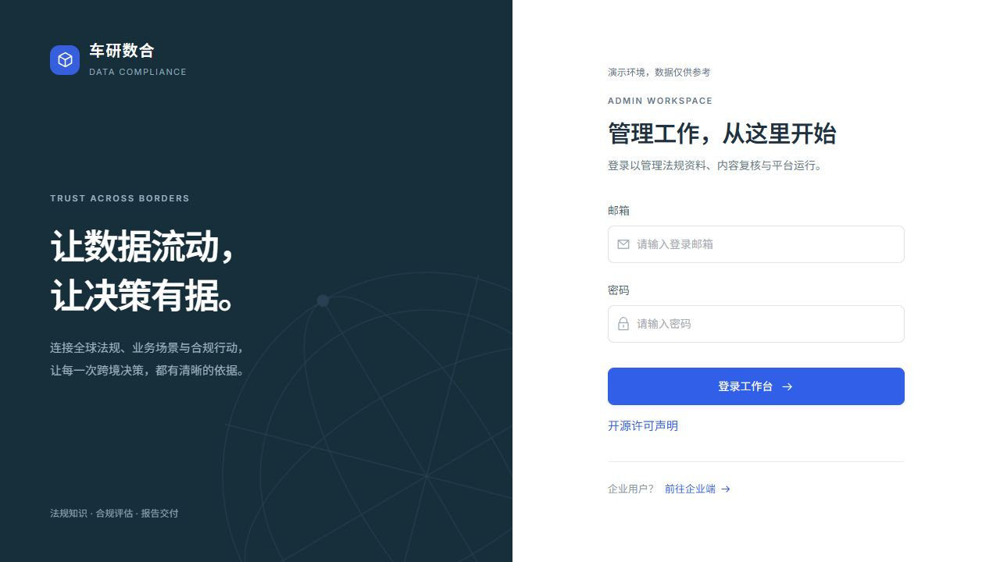

本说明截图来自 2026-10-25 的同一恢复数据集。法规、译文、图谱及工作流截图中，部分在上线前的受保护预发布入口取得；采集站点、更新、企业、账号、用户知识库、报告和追问截图来自公开 IP 入口。截图记录当时状态，页面数字会随新任务变化。

## 2. 企业工作台

### 法规知识库与国别概览

**作用**：按国家、文件层级和文件展开浏览，查看官方原文、条款、版本、中文对照及来源。国别概览用于定位资料覆盖，不能代替逐条的法律适用性审查。

**步骤**：进入“法规知识库” → 选择国家 → 展开文件层级/文件 → 查看条款和引用详情。核对文件标题、语言、版本、原文链接、日期及复核状态，再用于本次业务研究。国别目录展示的是已入库资料，不是该国全部法律。

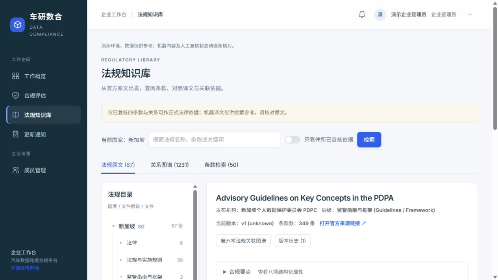

**限制**：当前五国管理库为 81 份文件、81 个版本、2,744 条条款；有范围外文件、OCR 和来源绑定隔离项，检索可用量小于管理库存量。部分日期/状态未知时保留待核对，不推测历史版本。原文、译文、语义关系分别复核，不能相互替代。对应会议中的国别查询、合规地图与原文可追溯要求。

### 聊天式合规评估

**作用**：采集企业业务事实，驱动检索、分析、核验与报告编制。

**步骤**：进入“合规评估” → “新建评估” → 选国家、车型、场景 → 回答数据类型、跨境接收方、保障措施、告知同意、留存和准入等问题。选项是示例，点选后按真实情况编辑，不要把示例中的措施当作已经具备。系统显示已记录事实后启动分析。

分析中若缺少用户事实，状态变为“等待补充事实”，聊天显示具体问题及原因。回答后仅重跑受影响维度，已完成维度保留；最多两轮，不能靠用户回答补造缺失法源。缺法源会显示证据缺口。对应会议中的过程追问与结构化业务事实要求。

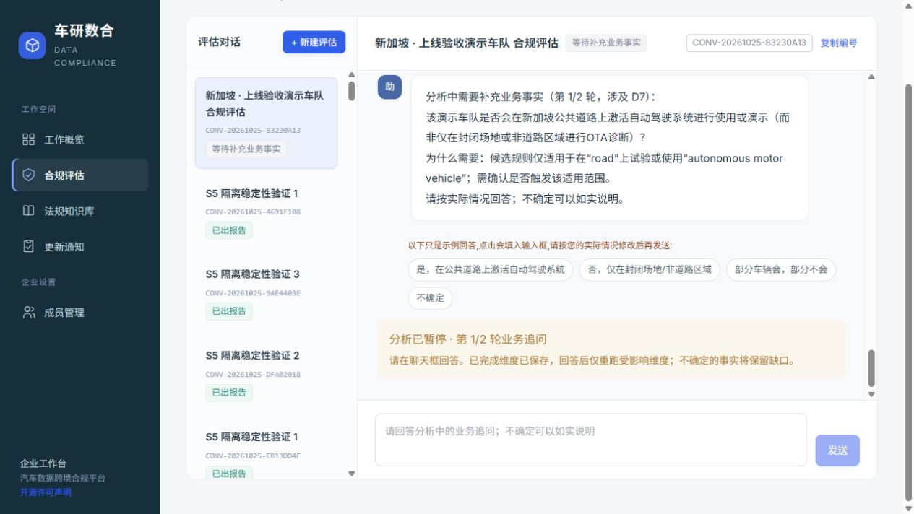

上图为线上演示业务 `CONV-20261025-83230A13` 使用真实外部模型时的暂停状态；模型是否追问取决于本次事实与检索结果，不保证每次都追问。演示业务明确标记为虚构，不是法律审批记录。

**进度与失败排查**：正常使用 SSE 实时推送；断线重连可补读已记录事件，异常时降级轮询并明确提示。失败时保留对话编号、步骤、工具输入输出、错误与工作流版本，交给管理员定位；先查失败步骤和核验详情，再决定续跑。反复点击新建会产生新任务和额外模型费用。

### 八维度报告、引用与版本

**作用**：把业务事实、适用条款、义务、风险与依据组织成八维度研究草稿。

**步骤**：选择已有对话 → 查看八维度章节 → 展开引用核对原文/版本/中文与复核状态 → 根据权限编辑草稿 → 保存新版本。导出菜单支持整份 Word/PDF、单个维度 Word/PDF，以及整份加 D1–D8 的 Word 压缩包。

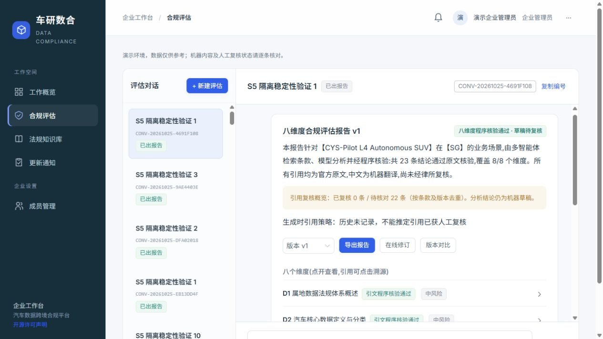

**限制**：默认 `allow_machine_with_notice`，允许机器处理内容进入草稿，逐条标明待核对；这项策略已经由用户确认。原文隔离、证据/数字/语义核验仍执行。严格策略可限制可引用内容，但不会将机器结果变成人工批准。策略在新任务/版本中留档；历史版本没有策略记录时显示未记录，不补写成新策略。导出使用所选报告版本的冻结快照，不借用任务最新结果。编辑后的文案仍须复核。

程序核验和独立模型支持度检查不能取代法律审核。无依据段落应保留缺口；不得直接修改原文或审批状态来让报告完成。对应八维度、逐条追溯、整份/拆分交付与版本留存要求。

### 更新通知与成员

**步骤**：进入“更新通知”，打开与本企业报告有关的来源变更提示；查看影响的条款/章节后重新分析，生成新版本。历史报告正文保留。企业管理员在“成员管理”查看本企业成员并按权限管理。

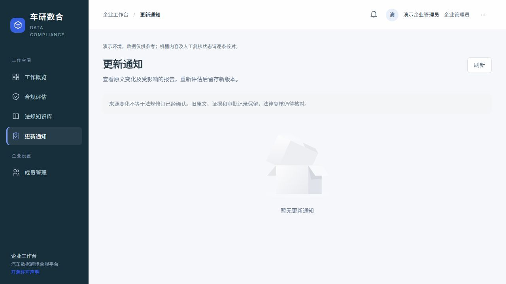

**限制**：来源内容变化只是待核对线索，不自动认定为法规修订或失效。监测以启用、条款确认且可访问的站点为范围；被 robots/网站访问限制阻止时记录原因，不绕过。当前通知为空时如实显示为空，不植入演示修订。对应更新影响与用户提示要求。

## 3. 管理工作台

### 采集站点与发现

**作用**：配置官方渠道、语言、入口、采集范围和计划，由确定性抓取器完成发现、下载、哈希去重、原文归档与版本观察。

**步骤**：进入“采集站点” → 查看/新增官方入口 → 检查 robots、站点条款与范围 → 由负责人员确认后启用 → 手动运行或等待调度 → 查看任务结果、发现候选、失败/部分成功原因。候选 URL 不等于已核验正式法规。

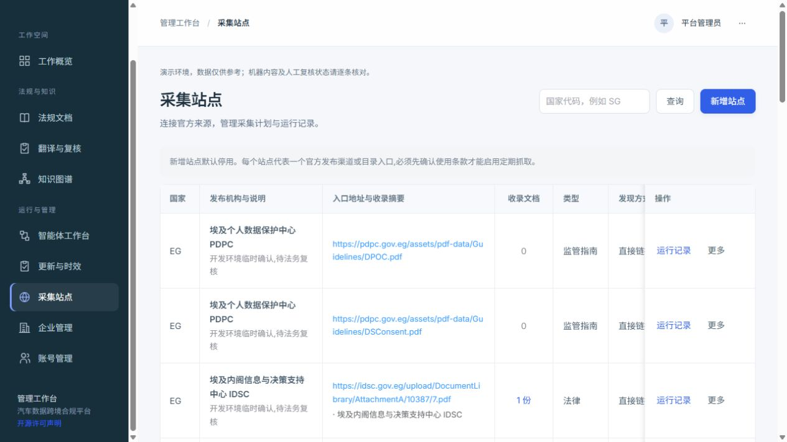

**限制**：21 个站点的条款状态继承原记录，并非本轮重新取得法务批准。黎巴嫩仍有一个待确认停用渠道；其他站点也可能部分成功、失败或被拦截。不能为取得数据将所有站点批量批准，不能绕过访问限制。新增国家/文档通过配置和通用解析器接入，不复制某国专用全流程。对应定期定点采集与手动新增网址要求。

### 法规文档、原文与版本

**步骤**：“法规文档” → 国家目录 → 文件层级 → 文件 → 查看官方来源和历史版本 → 查看解析、OCR、相关性与错误。上传甲方资料时保留来源性质，不覆盖已核验官方原文。原文绑定异常、OCR 缺字或表格切分错误应生成可追溯修复提案，保留旧条款和已有审批，重新处理后生成新记录。

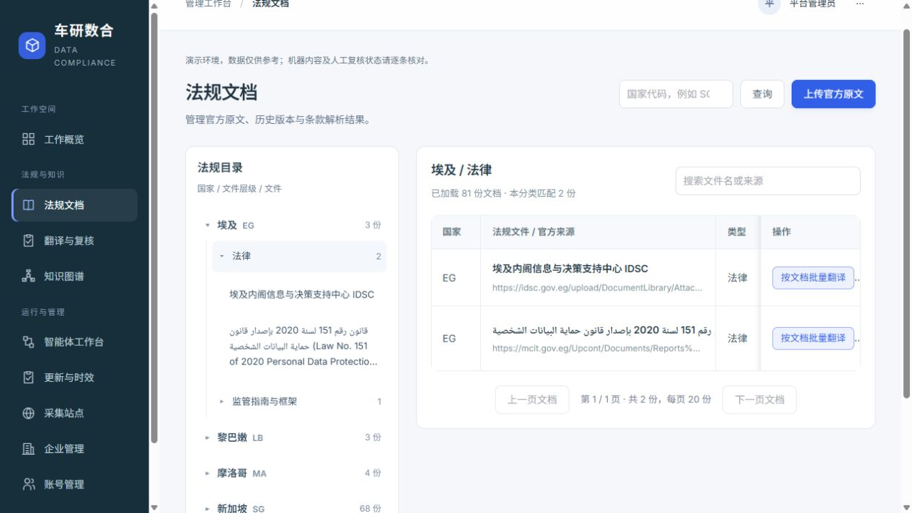

**限制**：库存文件数、相关文件数、检索可用数是不同口径。当前新加坡库存 68 份，其中一份有来源绑定隔离，因此用户查询可见数量可能为 67；不能解除隔离来凑数量。“80 余条”会议口径仍需区分 URL、版本、文件、条款。对应官方来源、版本时间与资料等级要求。

### 翻译、术语与人工复核

**步骤**：“翻译与复核” → 选择国家和状态 → 打开原文与中文对照 → 核对条号、数字、金额、日期、引用、例外与适用范围 → 有权人员提交通过/退回及理由。术语库用于保持译名一致，不能替代真正的全文翻译。解析、译文和图谱关系按各自对象复核，审批操作保留审计。

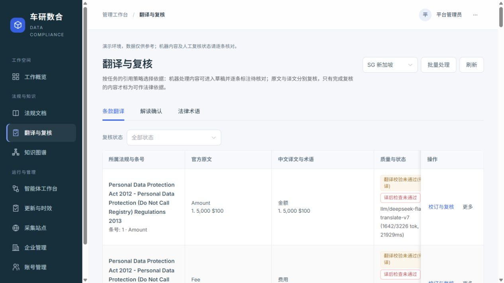

**限制**：所有新机器结果保持待核对。当前 API 审计列出 2,607 条当前译文，2,583 条机器翻译、24 条失败；失败/隔离记录仍保留，不应作为合格译文使用。没有核查人时不能批量“已批准”。这与会议的先机翻、后律所复核一致。

### 知识图谱

**作用**：以国家、监管机构、法规文件、数据类型、义务、罚则及语义关系组织可追溯证据，辅助发现关联、检索和更新影响定位。业务数据仍在 PostgreSQL 实体/关系表中；图形是投影，不是另一套真相。

**步骤**：“知识图谱” → 选择国家、关系和复核状态 → “全局总览”看整体 → “法规分组”逐个展开 → 点击节点/边 → 看证据条款、原文片段、版本、抽取与核验记录。读懂“全部关系 / 筛选后 / 当前展示 / 合并连线”的不同数字；缩略图/节点数限制不会删数据。

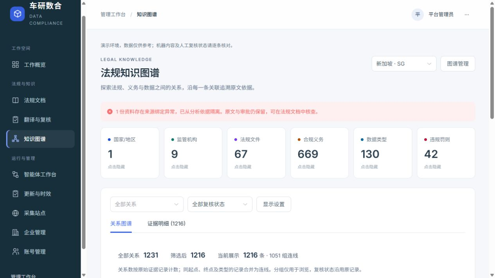

**限制**：当前活动关系 1,588 条，其中 1,406 条语义关系有独立程序/模型核验；待人工核对 1,430 条，已批准 158 条是保留的历史状态。旧规则边与被替代机器边保存在历史中，当前视图隐藏 3,661 条。引文存在不等于语义正确，模型支持不等于法律批准。图谱给 Agent 提供候选关联和影响路径，最终结论仍须回到有效原文证据。对应六要素、十二类关系与依据追溯要求。

### Agent 工作台、版本与评测

**步骤**：“Agent 工作台” → 选对话编号，查看状态、节点、工具、耗时、tokens、输入输出与核验结果；拖动节点调整浏览位置。布局调整不改执行拓扑。切换版本查看只读参数；导入白名单 DSL 后先生成未激活版本，管理员显式激活；要回滚时激活旧版。新任务锁定启动时版本，旧任务不随当前激活版改变。

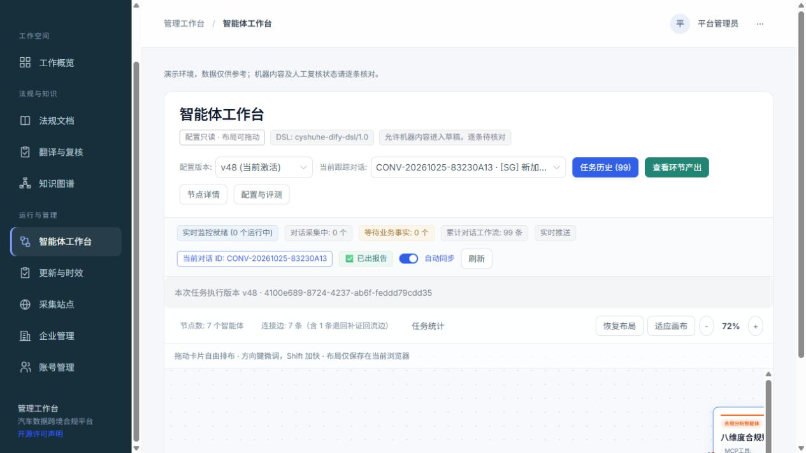

**可调范围**：按节点允许的 enabled、模型、temperature、system_prompt、top_k、退回轮次和超时。代码入口、工具绑定、拓扑禁止通过导入修改。画布当前查看的版本与所选历史任务版本可能不同，按界面的实际任务版本提示判断。

**评测**：打开质量/评测区，查看检索命中、引文忠实度、独立模型支持度、判定覆盖率和人工复核分母。2026-10-25 线上批次 32 题，人工 0/32；检索命中不能当作事实正确率。技术失败可追加重试但保留原记录，语义否定不能通过反复抽样删除。对应多 Agent 协作、MCP 过程、配置驱动、资源消耗与真实评测要求。

### 更新联动

**步骤**：“更新联动” → 查看定时来源观察 → 打开差异、受影响条款/报告章节和通知状态 → 核对官方版本信息 → 重新分析形成新报告版本。

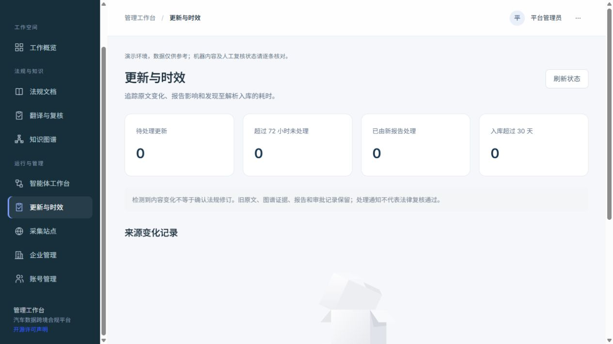

**限制**：页面当前 0 条变化不等于没有监测服务；表示该观察窗口没有记录到可展示变化。首次观察不能冒充修订。72 小时从平台首次解析发现开始计时，不承诺官方发布后 72 小时一定可采到。对应真实变更与影响传播要求。

### 企业、脱敏与账号

**步骤**：“企业管理”维护企业、引用策略和自定义脱敏术语；“账号管理”查看用户角色、企业归属与状态。新增/调整权限由有权管理员执行。企业数据隔离同时使用应用过滤与 PostgreSQL 普通运行角色的 FORCE RLS；数据库管理员不受同样边界，不应给业务进程使用所有者凭据。

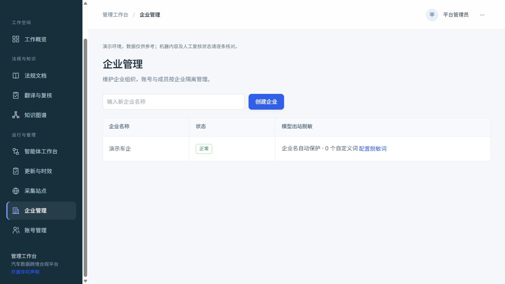

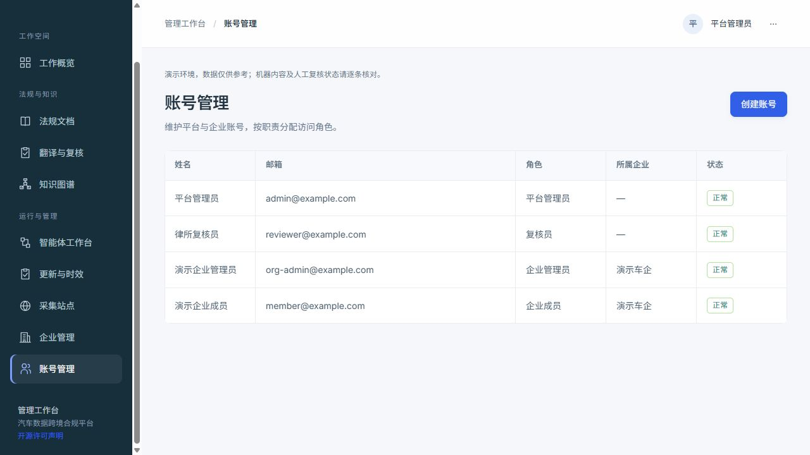

**限制**：出站模型调用默认脱敏并记录审计；自定义实体需要登记规则，自动规则不能保证发现所有商业秘密。支持兼容接口的本地模型配置，不表示服务器已安装或验证本地大模型。账号权限与人工法律复核资质是不同概念。对应租户、安全及外部模型使用边界。

### 开源许可与字体

两端页脚和登录页进入“开源许可声明”，查看锁定依赖、许可证全文及来源；字体随站点本地提供，不依赖字体 CDN。PDF 使用随包核验字体；Word 只声明字体名称，收件电脑缺字体时会回退。

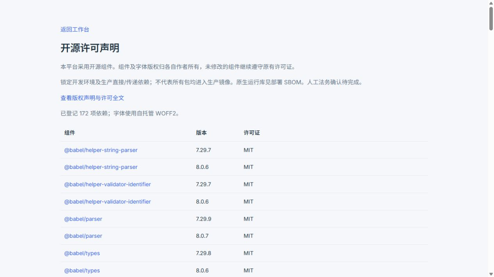

对应会议与交付中的开源合规、可读字体和产品说明要求。许可登记的人工确认状态以合规文档为准，不能把自动扫描通过当作法务审批。

## 4. 演示前的推荐路径

1. 登录企业端，查看五国目录，任选一条核对原文、译文和待核对状态。
2. 新建带“演示”标识的虚构业务，按实际设定回答问题；不要将虚构业务混作真实客户资料。
3. 到管理端用对话编号查执行版本、检索、核验和工具轨迹；如触发追问，回答后看受影响维度续跑。
4. 打开报告，检查八维度、缺口和引用，下载整份、单章与压缩包。
5. 看图谱总览与法规分组、采集记录和更新页。没有新修订或通知时保留空状态，不手工制造正式修订。

部署、备份和回滚见 [DEPLOY.md](../architecture/DEPLOY.md)；14 项问题与剩余边界见 [remediation_result.md](../architecture/remediation_result.md)。当前低配云机用于原型演示，尚未完成 100 人在线或 20 个 AI 报告同时执行的容量验收。
