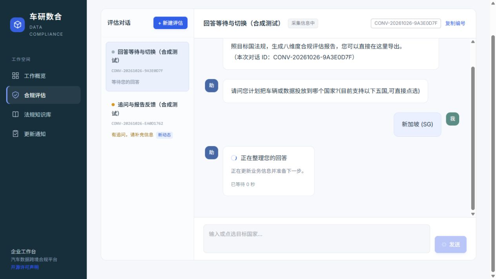
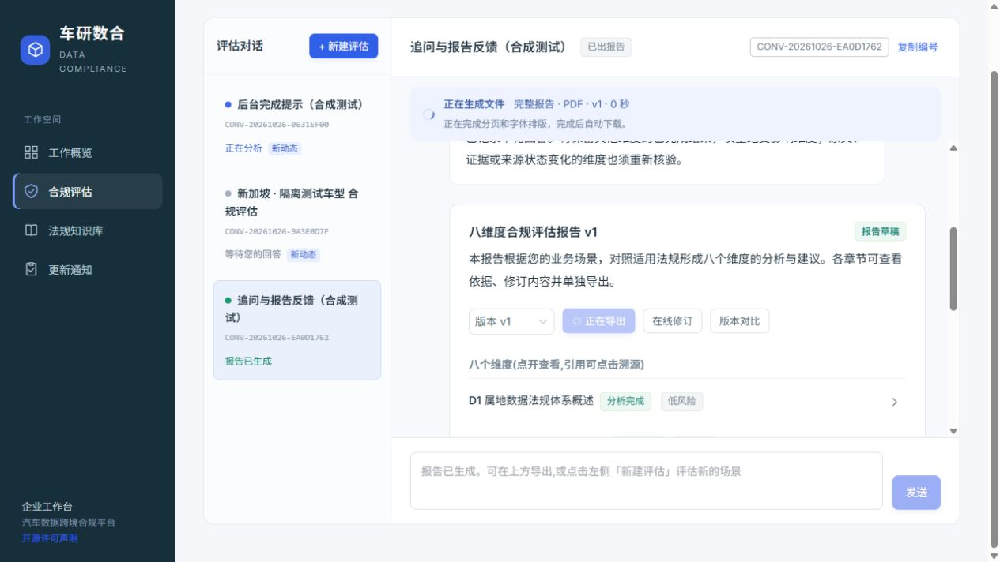
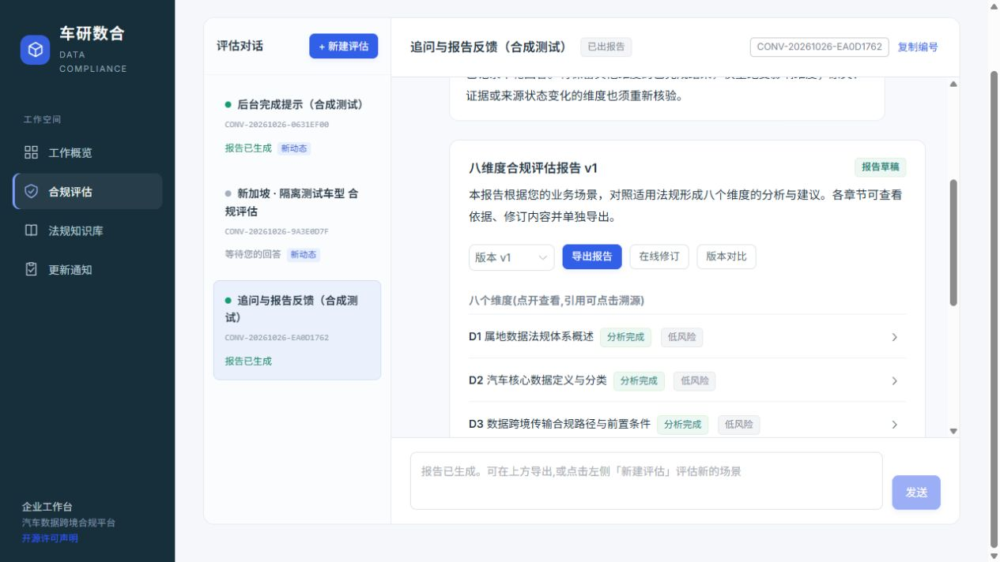

# 聊天反馈与报告导出改进（2026-10-26）

## 基线实测

使用线上既有报告导出，不新建业务任务、不调用模型。

|文件|等待响应头|文件传输|总时间|
|---|---:|---:|---:|
|完整 PDF|9.073 秒|0.132 秒|9.205 秒|
|D4 PDF|4.061 秒|0.044 秒|4.106 秒|
|完整 Word|0.089 秒|0.006 秒|0.095 秒|

等待响应头包含服务器检查和排版生成。本次瓶颈在生成阶段；传输约 214 KB 的完整 PDF 很快。服务器 CPU、内存、报告长度、字体排版和并行请求会影响生成时间；这些样本不代表并发压测。

## 第一阶段：实际进度与安全的 PDF 复用

- 从任务已提交的阶段启动事件读取业务环节和开始时间；普通用户只见业务标签，不返回提示词、工具绑定或模型思考内容。
- 进度中的失败、待补充和有缺口状态分别显示；不把失败轨迹标成完成。
- PDF 采用进程内、最多 8 MiB / 32 份 / 15 分钟的临时缓存，同一文件并发请求合并生成。服务重启清空缓存；不写原文归档。
- 租户/任务/报告标识、冻结报告内容、章节、任务展示字段及实时来源变更提醒构成缓存键。每次请求先检查登录、归属和来源隔离，再读取缓存。
- 新增响应计时，便于区分生成与传输。首次导出仍需真实排版；重复导出可以复用。
- 未变更数据库结构、原文、译文、证据、报告快照或人工审批。

第一阶段验证：后端专项 26 项通过（含暂停续跑、SSE、历史报告与租户权限）；原有 12 项反例全部通过；Ruff 通过。完整回归和浏览器结果在后续记录中补充。

## 第二阶段：对话及导出反馈

- 发送后立即显示等待气泡和实际等待时间；分析阶段显示已提交事件对应的当前业务环节、环节耗时和阶段摘要，不显示模型内部推理。
- 对话列表：蓝点分析中、黄点待回答追问、绿点报告可查看、红点未完成；文字标注确保不依赖颜色。未查看的新状态、消息或报告带“新动态”，标记按当前账号保存，只保存计数和状态。
- 当前任务使用原有 SSE；可见页面每 10 秒刷新其他对话状态，断线自动退回轮询。不宣称后台对话通知瞬时到达。
- 修复发送过程中切换对话时，迟到响应可能覆盖其他对话的问题；等待状态按对话隔离。
- 导出显示准备/接收、已用时间和实际字节数；准备阶段不展示虚构百分比。文件下载后提示查看浏览器下载列表，重复点击被拦截，服务器错误原因可见。
- 下载固定到点击时的任务、版本和章节；切换对话不改变文件名或导出目标。释放文件 URL 留出浏览器接收时间。
- 阅览较早消息时不强制拉回底部；明确打开对话和发送答案时仍定位到最新内容。动效遵守减少动画设置。

前端验证：42 项 Node 测试通过，SSE 客户端 5 项检查通过，用户端类型检查及生产构建通过。

真实浏览器在独立临时 PostgreSQL、合成法源与假 LLM 下完成：即时等待气泡、发送中切换及响应归属、黄色追问、回答续跑的真实阶段、后台报告变绿和新动态、PDF 生成提示及导出按钮恢复。本次未用假模型结果声称法律质量达标。

