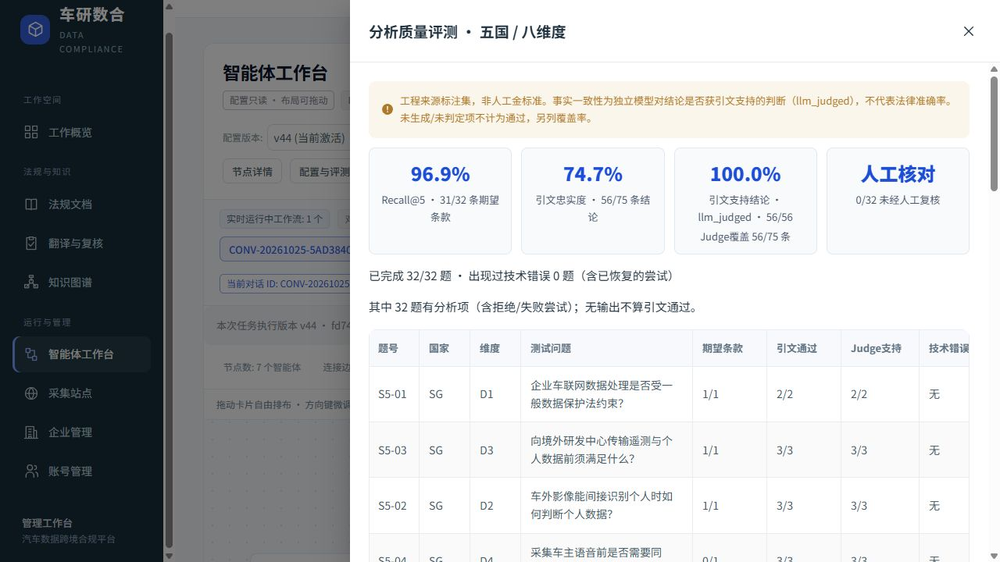

# S5 剩余召回、结论支持与成本修复

本轮在 `remediation_s5_fidelity_20261025` 隔离数据库执行；上一轮 v36 数据库与界面保留。
开始时冻结 20 表 30,285 条已有记录。原文、证据、审批与历史评测只读；后续配置、运行和评测追加记录，人工复核保持待核对。

## 阶段一：片段关联与检索成本

- 从哈希验证的归档重新解析条款，只有同版本、同章节、同标题、原文起始各行和续片逐字出现于同一解析条款时，才生成只读导航关联。不凭小数编号推定父子关系，不改历史条号。
- 返回续片时同时携带被证实的起始片段；起始片段占用真实 top-k 名额，不能拿它代替续片的引文证据。冻结评测 ID 与严格计数保持不变。
- 重排预览压缩到源文窗口，标记实际偏移；最终选证仍读取完整原文。
- 缓存只保存成功的检索结果，按调用者作用域、完整候选与复核状态、源版本、配置、提示词、问题和协议哈希隔离；30 分钟过期、最多 128 项、进程退出即失效。缓存命中明确记为 0 次请求和 0 新 Token，并记录原始消耗。失败结果不缓存。
- 阶段回归：64 项通过，包含原有 12 项反例以及新增的跨语言关联、版本隔离、缓存费用与失效负例。实际归档检验确认目标定义续片和起始片段可建立关联；最终召回以全套冻结评测为准。

## 阶段二：按源文单元生成

- 条文标题成为源文边界，不能把前条尾段与新条正文合并成一份引文；英文、法文、中文与阿拉伯文使用相同的边界原则，原文及偏移不改写。
- 多句或列表依据改用结构化 `units` 输出：全部源单元必须逐个、按序完整转述，由程序拼接。漏项、重复、乱序及单元内漏数字/日期均拒绝；不能借另一个单元的数字掩盖遗漏。单句继续使用严格规则/缺口互斥 Schema。
- 每次生成响应及失败原因保存在新运行记录中。OCR 关键动作、条件或范围不完整时返回证据缺口，不补字、不自动批准。
- 新协议为 `s5-source-coverage-cache-v5`，隔离库显式导入并激活 v38。旧协议配置和历史记录保留，不能把旧配置静默当成新执行配置。
- 阶段回归：后端全套 **402 项**通过；原 12 项反例在阶段一也已显式运行。前端共享逻辑 **34 项**、两端类型检查与构建通过。未变更冻结评测问题、期望条款 ID 或独立 Judge 提示词。

## 最终真实评测

### v38 中间批次（保留，不能当作全量完成）

- 严格召回 32/32；独立 Judge 57/57；技术错误 0；但最终有支持结论的题仅 **24/32**，低于 v36 的 27/32。埃及 6 题均没有获核验的结论，不能宣称五国已全部回答。
- 全部选择/重选尝试 78 项，57 项通过程序核验，21 项主要为源文缺口；Judge 只审程序通过项，覆盖率 57/78。拒答和无输出不计通过。
- 已知 Token 1,100,390，其中检索 610,682；与 v36 的 1,100,674 总量几乎相同，不能声称首次冷运行已显著降本。
- 十次报告均为完整待核对草稿，总 Token 1,430,559，缓存命中 72/80 次检索；但首轮退回 4/10，发现本轮“标题后接本条编号”被误当跨条边界的问题。该批次不满足首轮失败率 ≤30% 的目标，完整保留。
- 原始归档的只读恢复探测分别使用文字层与本地 Tesseract 阿拉伯文识别。新 OCR 虽能恢复一些词序，却把清楚的条号 97 识成 `/1107`，部分完整行仍丢失；不同识别对罚金表达也不一致。因此未自动替换任何原文或激活新的 OCR 文本，不能拿未经验证的新识别冒充修复完成。

### 阶段三：修正标题边界及重复输入

- 只有已解析标题与源文首个条号前的文字完全相同，才认定它们属于同一条文；不豁免真正跨条选择。新增四种语言/结构的正反例。
- 多单元生成只发送一次源文单元，完整引文、偏移、哈希仍在服务端证据记录，不重复把全文再发给模型。新增假模型请求体测试确认没有缩短或漏传原文。
- 后端全套 **407 项**通过；另显式跑原 12 项反例，全绿。v39 为同协议的新受控配置版本，真实评测与报告复测进行中。

### v39 中间批次与阶段四

- v39 严格召回 30/32，Judge 58/58，0 技术错误；出现一个职责名/原文谓词不一致导致的候选池漏召回，以及一个重排只返回 2 项导致的漏项。不能选取 v38 的更高召回替代本次结果。
- 增加**已有图谱的检索词汇通道**：只读当前版本、原文引文真实存在、语义核验 yes 且未撤销/驳回的义务、罚则和数据类型名称。沿用已有来源隔离；名称只帮助找候选 ID，不发送给分析智能体充当法条，也不写入审批状态。
- 词汇通道与原查询路线共享原有 40 项输入预算，不增加模型请求。模型重排少于 top-k 时，由现有本地候选填满剩余名额，并明确记录 `model_ranked_count`、`local_fill_count`；补入候选仍须经过相同的引文、数字、语义与就绪核验，不能因此发布不完整规则。
- 录制查询的无模型候选池回放确认职责条款可被重新找入；它只验证候选池覆盖，不是最终 recall@5 或法律结论通过率。
- 新增图谱标签不充当证据、已撤销/驳回/未核验/错误引文/规则引擎结果不复用等负例。最终后端 **417 项**通过；v40 受控配置已激活，继续真实评测。

### v40 中间批次与阶段五：语义质检

- v40 召回 32/32，独立 Judge 62/64，技术错误曾出现 1 题。新检出的两项偏差不能因它们不属于最初 8 项而忽略：`Article.` 缩写被切为孤立单元，另有一项引用限定仍不获支持。
- 修复 Article/Section/Regulation/Rule 带点编号的通用边界识别；跨条选证在原有两次选择预算内退回，不付费生成无效引文的中文规则，也不把选择错误伪装成法源不存在。
- 新协议 `s5-source-support-v6` 在依据生成后增加**源文—结论语义质检**。同一模型、温度、超时和已保存提示词驱动执行；管理员配置的固定参数 `verify_source_support=true` 不可导入关闭。不改节点拓扑或 MCP 工具绑定。
- partial/no 必须修改结论，最多沿用原有两次依据生成预算；相同原文与未改结论复用已得判定，不通过反复重判寻求 yes。服务不可用时阻断，不跳过语义质检。
- 被语义质检退回的原始结论保留。评测把“程序引文/数字核验”与“运行时语义准入”分开，**程序有效但语义被退回的提案仍进入独立 Judge、仍计分母**；独立 Judge 提示词和冻结问题不变。机器质检没有人工批准权限。
- 新增退回保留、相同结论不重判、质检中断阻断、不可关闭、跨条重选、缩写不成孤立片段等回归。后端最终 **428 项**通过；v42 已受控激活，全量实测进行中。额外语义调用全部计费统计，不能声称首次调用成本必然下降。

### v42 实测与阶段六：减少重复工作

- v42 完整 32 题：召回 32/32，独立 Judge 63/66（95.45%），程序有效提案 66/87，技术错误 0。三项未完整支持中两项是已被质检退回的旧提案，另一项最终结论仍与独立 Judge 存在分歧，保持待核对，未改评分。
- 按最终提案计算，只有 **24/32** 题含至少一项受支持结论；另 8 题没有，不能等同“24 题完整回答”。埃及 6 题均未形成可用结论，原文恢复仍未完成。
- v42 十次报告均完成、均为待核对草稿；首轮交接失败 1/10，退回后恢复。已知 Token 2,285,692，比 v36 十次的 2,582,365 减少约 11.5%；但全套冷评测 1,347,062 Token，比 v36 增加约 22.4%。新增语义质检确有成本，不能只展示缓存收益。
- 增加完全相同作用域/源文/参数检索的并发合并；十个并发合成请求只消耗一条规划/重排链路，失败结果仍失败且不缓存为成功。这不是 20 个真实报告的容量验收。
- 修正重选机制：自动核验通过项按原文哈希和精确位置再核验后原样保留，只重试失败名额；重复选择保留项被拒绝，保留项不重复计为新提案/新生成。源文或锚点变化立即阻断复用。补证仍失败时保留已有依据，但不能把报告标为完整。
- 语义质检 JSON 枚举/格式错误只重试格式，不重写已通过的规则；合法 partial/no 不重判。修复提示词中枚举示例的歧义，保留失败响应与全部已知费用。
- 语义判定与逐段转述结果随新报告引用一起保存，仍标记 `human_review=null`。本阶段回归全套 **436 项**通过，另有单项失败轨迹记录补充验证；最终配置及实测记录在收尾时追加。

### v43 与阶段七：限定修复时的可选证据

- v43 完整批次：召回 32/32，独立 Judge 49/49，程序有效 49/73，技术错误 2 题，至少一条最终受支持结论的题 24/32。已知 Token 1,257,921。不能把 49/49 理解为所有问题均已回答。
- 两次技术错误分别涉及重复选择保留项、选择跨越独立条文。保留全部失败轨迹与评测分母，不以旧批次替代本次结果。
- 选证目录新增与原文标题边界一致的 `scope_id`，向模型明确同一项不得跨范围；修复时只开放失败事实键和未完成的源文句子，已完成句子仅作为上下文。原始句子编号、偏移、原文及已通过结果不变；同一依据对另一个尚未完成事实仍可选。
- 后端全套 **437 项**通过，原 12 项反例再次显式全绿，Ruff 检查通过。v44 在隔离库受控导入后显式激活，最终真实复测使用该版本。

## 最终交付状态：v44（并非全部问题清零）

运行配置：`fd748445-aa20-484f-81ad-19e9ed45c84d`，协议 `s5-source-support-v6`。
最终批次：`b8620716-d6f0-47cc-abe6-7e5b60303d23`；32 题完整执行。
冻结题集与独立 Judge 提示词哈希和 v36 相同；人工复核 **0/32，仍待核对**。

| 指标 | 本轮前 v36 | 本轮最终 v44 |
|---|---:|---:|
| 严格 recall@5 | 31/32 | 31/32 |
| 引文逐字、源位置与数字核验 | 74/80 | 56/75 |
| 独立 Judge 完整支持（llm_judged） | 66/74，89.19% | 56/56，100% |
| 技术错误题数（包括恢复前） | 1 | 0 |
| 至少含一项最终受支持结论的题数 | 27/32 | 26/32 |
| 10 次同输入报告完成 | 10/10 | 10/10 |
| 报告首轮整体核验失败 | 1/10 | 0/10 |
| 整体退回轮数 | 0 轮×9，1 轮×1 | 0 轮×10 |

**100% 只表示 56 条程序有效提案被独立模型判为完整支持，绝不表示 32 题完整回答或法律准确率 100%。**
75 次提案中的其余 19 次仍计入程序核验分母。局部格式重试、语义退回和重选仍有发生，0 次整体退回不代表没有局部失败。
26/32 只统计“至少一条最终结论获支持”，不验证整题完整性；S5-24、27、28、29、31、32 没有最终受支持结论，不能记为通过。

### 召回与原先八项不足的逐项去向

原先唯一漏项 S5-02 的定义起始片段与续片已实际命中，均占真实 top-k 名额。
新加坡仍为 7/8，突尼斯 6/6；本次新的未命中是 S5-04：候选池包含指定条款，但重排选中另一份官方原文同名同号条文。
选中的 2012 年归档写“appointed day”，指定 2021 年归档写明“2 July 2014”，文档、版本、文字均不同。
因此严格计为未命中，不合并身份、不改期望 ID、不依据 URL 年份猜定当前有效版本。
**总召回未比上一轮提高**；后续还需通用的法源身份、版本消歧与官方时效信息补全。

| 原问题 | 最终实测状态 | 能否认定原项修复 |
|---|---|---|
| S5-16 法定代表人主体偏差 | 同一原条款的新结论获独立 Judge 支持 | 机器核验已修正，人工待核对 |
| S5-19 前条尾段误并入第 52 条 | 阻止跨条拼接；其他法源结论获支持 | 原条款未确认恢复，不计清零 |
| S5-22 遗漏研究用途例外 | 原有有缺陷提案未放行；其他法源结论获支持 | 原条款未确认恢复，不计清零 |
| S5-24 类别及许可机关不完整 | 关键阿语/OCR 无法可靠还原，保留缺口 | 未完成 |
| S5-25 “前一条”被译为“上一章” | 同一原条款的新结论获独立 Judge 支持 | 机器核验已修正，人工待核对 |
| S5-27 关键禁止行为残缺 | 原始 OCR 行为/同意主体不完整，阻断最终规则 | 未完成 |
| S5-32 罚则范围不足（原有两次提案） | 金额连接词及对象受损，两次原错误均不放行 | 两项均未完成 |

即原八次问题提案中，两次同一原条款已获得新的机器支持结论；两次改用其他法源，不能认定原条款已恢复；四次仍因来源缺口受阻。
没有把拒答当作“原文修复成功”，也没有通过补字、降低数字标准或自动人工批准解决问题。
原始归档恢复探测未找到可无损自动替换的结果；应从官方取得更清晰/可检索原文，或对新解析候选逐页核验后受控追加版本。

### 实际成本与验证边界

| 已知 Token | v36 | v44 | 变化 |
|---|---:|---:|---:|
| 32 题冷评测，含独立 Judge | 1,100,674 | 1,282,616 | 增加 16.53% |
| 其中检索 | 660,201 | 610,865 | 减少约 7.47% |
| 10 份同输入报告，含运行时语义质检 | 2,582,365 | 2,064,714 | 减少 20.05% |
| 平均每份报告 | 258,237 | 206,471 | 约减少五分之一 |

最终 80 次维度检索中缓存命中 72 次，仅首份产生 16 次规划/重排新请求，检索已知 Token 146,781。
缓存作用域、源文、版本、状态、参数和提示词变化均使复用失效；失败不缓存成功。
首份报告 331,244 Token，后九份平均约 192,608；全部源文和必要核验照常保留。
冷评测与十份报告曾同时使用隔离服务，耗时记录分别为 699.14 秒和累计 737.81 秒，**不作为独占服务性能或 20 并发容量结论**。
当前没有增加额外模型复跑来追求更好分数。归档中间批次与最终批次的已知消耗合计 **13,084,426 Token**；这是工程验证消耗下界，不是人民币账单。供应商缓存计价、未返回用量的失败和未归档探测需以实际账单核对。

### 回归、引用和保护核对

- 后端全套 **437 项通过**；原 12 项反例再次单独通过；Ruff 通过。前端共享逻辑 34 项及两端类型/构建检查在本轮早期通过，之后没有改前端产品代码。
- 汇总工具另验证三项报告完整性反例：不足十次、输入事实变化、混合工作流版本均拒绝生成可比统计。
- 工作台真实浏览器验证通过：最终 32/32 题、实际指标、人工 0/32 及任务执行 v44 可见。查看页面没有触发新模型请求或批准操作。
- 十份报告 **239 条最终引用**全部核对原文 SHA、原始位置、文档与版本、数字和机器语义记录；`human_review` 全部为空。它不是逐条人工法律核查。
- 新报告 Word/PDF 均 HTTP 200，Word XML 有效，PDF 14 页，首页渲染目检通过；本次没有重做全部页面排版审查。旧失败任务 `99e117fa-b2ca-45b2-ab50-387989638bb6` 的两类导出仍返回 409。
- 对开始时 **20 表 30,285 条原有记录**逐字段核对，原文/证据/审批覆盖 **0**，旧执行 ID 回填 **0**；80 份原文归档哈希一致。旧 v36 的激活标记变化有变更前快照；新增任务、配置及审计仅追加在隔离库。
- 原开发库、v36 隔离环境和生产服务器未修改。当前管理端为 `http://127.0.0.1:5188/agent-studio`，API `18008`；原 `5187/18007` 保留。
- 最终恢复备份在 `C:/Users/Jin/.cyshuhe-dev/backups/20261025-S5-fidelity-final`：21 张表、80 份归档，备份目录验证通过；未再次开展恢复演练。数据库 dump SHA256：`f3cc0d24da06b1a6a901630af03da93963e21de36a91a688792ac33347b25bf4`。数据库及密钥不进入 Git。

### 提交与查验入口

工程分段提交：`44f6e1e` → `7057ad5` → `076dc06` → `7a4e015` → `71525a2` → `f41be48` → `c983849`；中间批次/失败证据在 `9b5d785` 归档。最终验证和本记录单独提交在同一独立分支 `codex/remediate-s0-s3-s1-s2`，未推送远端。

- [最终评测报告](../architecture/eval_report_20261025_v44.md)
- [完整前后对比与原八项去向](s5-fidelity-cost-20261025-comparison.json)
- [十次真实报告](s5-fidelity-cost-20261025-v44-stability.json) / [退回统计](s5-fidelity-cost-20261025-v44-backtracks.json)
- [逐条引用核对](s5-fidelity-cost-20261025-v44-citations.json) / [旧记录保护核对](s5-fidelity-cost-20261025-final-preservation.json)
- [浏览器回归](s5-fidelity-cost-20261025-ui.json) / [导出验证](s5-fidelity-cost-20261025-v44-exports.json)

