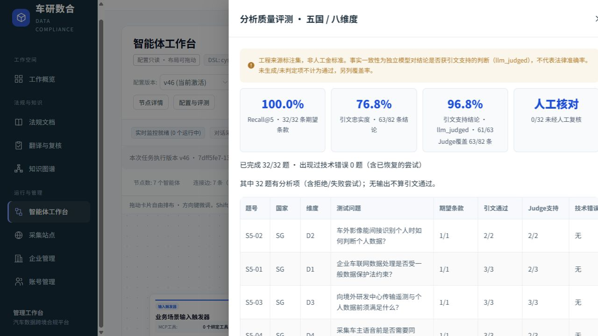
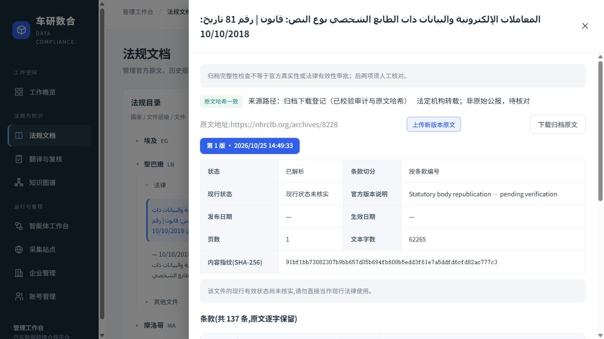

# S5 官方原文、版本消歧与 OCR 候选修复

基线为 v44 最终备份；恢复到新的隔离库 `remediation_s5_sources_20261025`，20 表 30,755 条旧记录在开始时逐字段冻结。旧环境和生产服务器不动，题集、期望条款和独立 Judge 提示词不改。

## 第一阶段：通用来源比较与结构解析

- 法规身份不按国名、标题或测试题硬编码。通过追加 `source_identity_observed` 记录登记，逐次校验文档/版本/国家/URL、归档 SHA、证据摘录和审计哈希；冲突身份不应用。登记只用于检索比对，不能认定同等法律效力或现行状态。
- 对同身份、同角色、同编号且无附表重号歧义的条款，增加另一个来源/版本的比较入口，**占真实 top-k 名额**，不扩充分母外的候选，不替换原条款 ID。不同国家、修订文件/基础法、不同章节或同文档重号不得配对。
- 模型接收到真实来源 URL、版本 ID、版本号及未知有效状态；不同来源引文禁止拼接。原有引文、数字、语义及人工审批边界不放宽。比较路线本身不调用大模型。
- HTML 根据编号式法条标题选择包含所有法条标题的最小正文容器，保留全部法条文本；没有充分结构时沿用原解析。身份元数据从整份归档另行校验，不能把新闻导航或网页标题当成法条内容。
- 新增非试点虚构国家、中文/英文/阿文格式、附表重号、错绑、跨来源、审批越权及标题/正文隔离的正反例。回归结果见同目录 `s5-sources-20261025-stage1-final-regression.xml`；原十二项反例已单独通过。

## 官方渠道核查（零模型调用）

- [黎巴嫩中央银行 PDF](https://www.bdl.gov.lb/CB%20Com/Laws%20And%20Regulations/Laws/Law_81_AR%C2%A72572_1.pdf)：遵守 robots 下载成功，但 SHA 与旧归档完全相同，没有获得更清晰的新版文件。
- [黎巴嫩国家人权委员会逐条 HTML](https://nhrclb.org/archives/8228)：遵守 robots 下载并归档；其[机构说明](https://nhrclb.org/en/what-is-nhrc)表明它是依法设立的独立国家机构。按“法定机构转载”登记，不能标为原始公报或已确认现行法。
- 埃及数据保护中心 `pdpc.gov.eg`、原 MCIT PDF 及新加坡原电子公报下载：采集器无法确认 robots，已停止，没有绕过。Web 搜索结果、律所翻译、新闻摘要均不冒充已取得的官方法规全文。
- 新加坡旧归档的两份官方文件仍可只读比对。2012 文件首页图像为正式公报，文字层夹有 Bill 字样；身份摘录采用实际公报发布说明，不凭混入的文字层猜测法律状态。2021 修订版首页列有修订版说明。二者独立保留，不按链接年份自动判定现行有效。

采集成功、失败和本地代理 DNS 适配记录见 `s5-sources-20261025-acquisition.json`；开发机仅对域名解析的 `198.18.0.0/15` 使用既有代理适配，字面量私网与所有 robots 检查仍有效。

## 本地 OCR 探测（不自动启用）

复用 [Tesseract 官方 tessdata_best](https://github.com/tesseract-ocr/tessdata_best)，Apache-2.0；阿语权重 12,603,724 字节，SHA256 `ab9d157d8e38ca00e7e39c7d5363a5239e053f5b0dbdb3167dde9d8124335896`。GitHub API 版本查询遇到限额，使用官方 raw 文件并固定内容哈希，不猜提交号。

对原埃及 31 页扫描件，以 300 dpi 保留水印和原始图像，分别运行 LSTM 的 PSM 3、6；保存每个字词、边界框、置信度、页图哈希和全部原始识别结果。约 52 秒，零大模型调用。
两模式 **0/31 页逐字一致**；关键主体、条号和罚金连接词仍有差异，不能靠较高置信度或手工补字替代核验。全部保持 `pending_review / active=false / usable_as_legal_basis=false`，不会自动进入报告依据。

## 第二阶段：候选登记与结构格式修正

- 清晰 HTML 单独建立一份文档和版本，137 个条款块（含一段发布条文），未覆盖中央银行 PDF 的条款、译文或审批；新站点保持停用且采集条款 `pending`，未擅自确认计划采集许可。
- 新文档明确标记为法定机构转载。该标记传入模型、报告 JSON、章节说明以及 Word/PDF 引用，不冒充原始公报；所有新引用带独立文档、版本 ID。旧报告不回填。
- 追加四条归档绑定的法规身份观察；它们只是检索比对元数据，不是人工批准、现行性判定或法源等价结论。
- 对新文档随机抽查 20 条，仅作程序性哈希/原文子串完整性核对，错误 0；不是人工法律抽查。20 表 30,755 条旧记录逐字段一致，81 份文档原文归档哈希通过。
- 埃及完整双模式 OCR 记录作为 `source_ocr_revision_proposed` 与变更提案追加，31 页全部保持未启用；已有扫描件和历史条款不变。
- 首次零调用回放仍为 31/32，发现对应章节 `PART IV` 与 `PART 4` 的表示不同。仅对 PART/CHAPTER/DIVISION 的合法罗马结构序号做等值规范化；不改原文，不把无效罗马序号或一般单词转换成数字。修正后回放 32/32；这是旧排序的比较路线回放，不能当作新真实评测。
- 回归 **465 项通过**，原十二项反例再次单独通过，Ruff 通过。保护核对脚本支持独立归档根目录和严格的映射/列表基线，只有数据库声明的 JSON 列进行解码；原基线文件保持原样，SHA 见保护核对记录。
- v45 在新隔离库显式导入、激活：`583c4626-685d-4816-81cb-4ff7d41ccb5a`。保留 v44 环境，最终真实验证使用 API `18009` / 管理端 `5189`。

## 第三阶段：首轮真实评测与完整列表选证

v45 完整冻结题集：检索 **32/32**，程序引文核验 **60/76**，独立 Judge 支持 **58/60**，人工 **0/32**。已知 Token 1,316,542，总耗时 648.25 秒。所有局部失败尝试都在分母内，无输出不算通过。

发现一项真实技术错误：完整法律列表被模型选成 7 个句子编号，超过保持不变的 6 项选证上限。按结构把明确引导语和连续完整列表组织成一个选证单元，仍逐个列表项进行语义覆盖、数字与日期核验；不补字、不增加上限、不跨独立条文标题。阿语含空格的条文关键词也只用于边界识别，不修改源文本。新增跨语言、九项列表及跨条文反例。

独立 Judge 的两项未充分支持也保留：一项是法语主体名称的中文译名分歧；另一项旧 OCR 的复合部长主体被错误拆开，运行时核验已拒绝，后续生成改正后另记为新尝试。不是把已拒绝结论加入报告，也不把机器判断当成人工核验。详细原文、判断和接纳状态见 `s5-sources-20261025-v45-diagnosis.json`。

v45 另做 3 次同输入端到端集成，全部完成八维草稿，工作流退回 0/3、部分样稿 0/3；局部选证/生成失败仍保留。71 条最终引用通过原文 SHA、偏移、文档版本、数字及机器支持状态核对。3 次共 767,083 Token，对比 v44 前 3 次 707,775 Token 增加约 8.38%；不宣称单报告成本下降，也不把 3 次集成当成 10 次稳定性或并发容量测试。Word/PDF 导出成功，原失败任务两种导出仍为 409。

列表修改后全量回归 **469 项通过**，原十二项反例单独 **12/12**。因真实代码修改，随后再做一轮完整冻结集与 1 次端到端集成；首轮失败批次、全部调用量与分母继续保留，不重跑未改动版本挑分数，不为新正文全量预翻译。最终结果和保护核对在下文追加。

## 下载登记展示与额外核查

浏览器发现新文档被详情接口误标为“历史迁移／记录不足”。增加只读下载登记识别：必须同时满足文档/版本绑定、归档哈希和长度、来源 URL、robots 许可、审计哈希与来源性质；缺项、冲突或损坏仍降级为记录不足。详情明确显示“法定机构转载；非原始公报，待核对”，不改变源记录、有效状态或审批。

补充主体错绑、错误哈希、URL 不同、robots 拒绝、伪审批、错误来源性质和接口降级反例。全量回归 **476 项通过**，原十二项反例单独通过；全部后端 Ruff、两端 TypeScript 类型检查通过。263 个 Python/JS 依赖的许可证门禁通过；`tessdata_best` 的独立权重登记为 Apache-2.0，未切换生产 OCR 配置。

额外发现埃及官方资源链接，但采集器对 `www.pdpc.gov.eg` 仍无法确认 robots；未请求正文、未入库。二手页面仅用于发现链接，其法律内容不计为证据；其中一条转载链接本身不完整，也没有猜测补全。记录见 `s5-sources-20261025-additional-official-leads.json`。

## 最终真实评测（v46）

激活版本 `7dff5fe7-1396-4000-b982-8f32eeb0d054`，冻结批次 `62620731-d335-4dd6-8614-8d8cb56ac0f6`。32 题与独立 Judge 提示词哈希均与基线相同，未改期望条款或评分规则。

| 指标 | v44 基线 | v45 首轮（完整保留） | v46 最终 |
|---|---:|---:|---:|
| Recall@5 | 31/32 | 32/32 | **32/32** |
| 程序引文核验（含失败尝试） | 56/75 | 60/76 | **63/82** |
| 独立 Judge 支持（llm_judged） | 56/56 | 58/60 | **61/63** |
| 技术错误题数 | 0 | 1 | **0** |
| 至少一条最终结论获支持的题数 | 26/32 | 25/32 | **26/32** |
| 人工复核 | 0/32 | 0/32 | **0/32，待核对** |
| 已知 Token | 1,282,616 | 1,316,542 | 1,343,482 |
| 客户端耗时 | 699.14 秒 | 648.25 秒 | 586.03 秒 |

“至少一条获支持”只说明该题有部分可用陈述，不说明完整回答，更不是法律准确率。v46 的两项 Judge `partial` 分别为“access 条件被误译成拥有”和“by an organisation 被误译成向组织”；**两项均已被运行时语义质检拒绝**，保留在总分母内，未进入最终结果。最终尝试的附加诊断是 59/59 获 Judge 支持，不能用它替换上表 61/63 的总指标。

新加坡召回 8/8，其余四国各 6/6。黎巴嫩健康/遗传数据问题（S5-24）现在有获支持的最终陈述；先前七项选证报错（S5-22）也已正常完成。埃及 S5-27～S5-32 六题仍没有最终受支持陈述：缺损涉及同意主体、保留和处理条件、儿童数据条文、跨境例外、许可撤销情形、罚则范围。**S5-30 相比 v44 本次没有可用结论**，完整上下文中的关键 OCR 条件缺失，不能把旧轮次存在一条获支持陈述当成本次可以补全原文。整体受支持题数因此仍为 26/32，不能声称全部八项历史支持问题都已解决。

细节见 [评测明细](s5-sources-20261025-v46-evaluation.json)、[未通过原因](s5-sources-20261025-v46-diagnosis.json)、[跨版本比较](s5-sources-20261025-final-comparison.json) 和 [完整评测报告](../architecture/eval_report_20261025_v46.md)。

## 报告、数据保护和成本

- v46 仅新增 1 次同输入八维报告集成：`4691f108-d449-435c-bd28-f0aac3f79401`，完成 `full_draft`，工作流退回 0、首轮整体核验失败 0；局部生成失败 1 次仍留痕。耗时 121.93 秒、324,844 Token。与 v44 首次冷报告 331,244 Token 比较约降 1.93%，仅一个样本，不是稳定性或普遍降本证明。
- 23 条最终报告引用通过原文 SHA、逐字偏移、文档与版本、数字及机器支持检查。Word/PDF 均返回 200；PDF 14 页，首面渲染抽查可读，未声称全 14 页逐页版式验收。历史失败报告的两种导出继续 409，历史记录未改写。
- 此轮两个完整评测批次加 3+1 次报告集成，总已知 Token **3,751,951**，包括失败尝试。最终冷评测相对 v44 Token 增加约 **4.75%**；版本比较和更完整证据有额外消耗，没有为了降低数字缩小失败分母。官方发现、下载、哈希去重、来源比对及双模式 OCR **零模型调用**；没有全量预翻译、重建图谱或重复十次报告。计费仍以供应商账单为准。
- 最终逐字段核对 **20 表、30,755 条旧记录**，原文/证据/审批覆盖 **0**，历史执行版本回填 **0**，81 份原文归档哈希通过。旧 v44 激活标志变化有激活前快照；其余旧字段未改。新增 1 文档、1 版本、137 条款块、1 个停用来源、1 个未启用 OCR 提案、2 配置版本、4 个隔离报告任务；未新增译文审批或图谱审批。
- 浏览器 CUA 只读手点通过：国别/文件目录、新旧来源并存、转载与哈希说明、v46 执行轨迹、32 题质量看板与人工 0/32。未运行旧版硬编码端口且会提交审批的 Playwright 脚本，以免更改复核状态；本次范围见 `s5-sources-20261025-ui.json`。
- 最终一致性备份：`C:/Users/Jin/.cyshuhe-dev/backups/20261025-S5-sources-final`。数据库转储 SHA256 `a01d165ac2663bf5e7a2b4604196a8263a4072c24c1c882860c632b21b922cfc`；21 表、81 版本，备份目录验证通过，另保存 161 个 OCR 原始输出/字框/图像/权重文件及逐文件哈希。本次未再次完整恢复最终备份；最初 v44 基线已实际恢复到新隔离库。

## 尚未完成与使用边界

1. **埃及原文缺口未解决。** 官方站点访问/robots 失败、双模式 OCR 仍分歧；候选不启用，不能补字、拼接二手译本或放宽核验。后续需取得可验证的官方清晰原件，再按同一候选归档与核验流程接入。
2. **版本比对不等于法效消歧完成。** 当前只是对有归档摘录证明的登记身份提供对应条款比较；不同版本不合并，未知现行性继续未知。法规身份登记、有效日期与法源性质仍需人工核对。
3. **清晰 HTML 不等于全部条款已法律核验。** 137 是解析块数，含发布材料、网页关联提示；发布部分与主文存在重复编号，首条仍含发布条文和主文材料，不能把数量当作 137 个独立法律规范已逐条验收。适用条文与具体选证仍受边界、语义及人工待核对限制，后续结构审查不得覆盖既有来源与审批。
4. 本次不自动重建五国图谱、不回填旧报告、不批准译文/法源，不声称通过全部法律验收、20 并发或十次稳定性测试。新的数据和 v46 在 **API 18009 / 管理端 5189**；原环境、生产服务器均保留。

工程分段提交：`64c23de`（来源比对）、`7ac4575`（原文/OCR 候选与结构版本）、`1b1c44b`（完整列表选证）、`ac38a7a`（下载登记展示）；最终评测、保护核对及浏览器证据另以验证提交留存。

