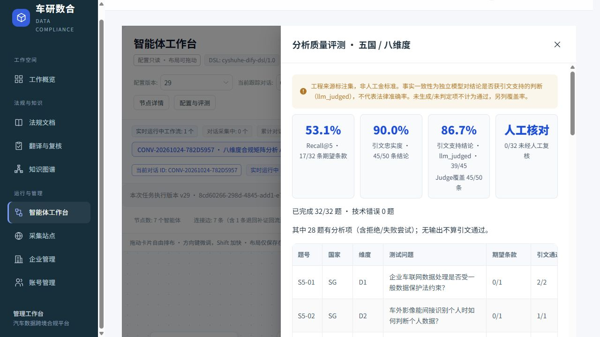

# S5召回与结论支持度改进

## 修改前诊断

固定原32题和原Judge协议，基线批次 `d70b92c6-9da2-4d47-8011-d532e475ad16`：Recall@5 12/32；引文忠实度71/71；独立模型完整支持47/71；人工0/32。

只读检查20个未命中：12个维度关键词不匹配、8个排序低于第五。期望条款均仍在来源约束允许读取的候选集中，没有靠解除来源隔离或降低原文质量门槛修复的理由。

检索函数只接收维度；具体问题未用于排序。正文与标题关键词词频不能处理用户中文问题与英、法、阿原文之间的词面差异，也不能区分同一维度下的数据质量、保存期限、负责人任命、行政准入等不同问题。

24条独立Judge判为partial/no的结论，保留逐字理由，主要涉及：引用列表子项丢失上文的主体/许可条件/处罚；结论遗漏条件和替代主体；把片段没有说的事项推断为规则；对OCR受损文本补全含义。程序子串核验不能识别这些语义问题。

诊断：[只读结果与原Judge意见](s5-quality-20261024-diagnosis.json)。本轮另从S5最终备份恢复 `remediation_s5_quality_20261024`，保留原S5副本；修改前29,520条旧记录已在本机私有快照中保存。

## 通用修复方向

1. 将真实业务问题接入检索；用原文、解析标题和当前机器译文作多通道词法召回与融合。译文仅辅助找候选，最终依据仍取受原来源闸门约束的原文。索引规范化与原文校验分离。
2. 保留列表导语和限定语的完整证据单元，引用仍是原文连续子串，不补字、不跨条款拼接。
3. 将“选证据”和“写结论”分开，后一步仅看到已选择的完整原文依据，避免从其他候选段落借结论；维持原数字、币种、日期、来源和审批约束。

不读取期望答案参与排序/生成，不按国家、法规名、条号、题号分支。评测题和Judge保持冻结；新增合成反例使用内存或独立测试库。

## 已实现的修复与工程回归

- `retrieval.py` 使用正文/当前译文、解析标题/原文首行的BM25通道，通过RRF融合。真实业务事实按现有维度映射选择；无对应槽位时不把其他维度的数字与业务细节冒充检索问题，新业务字段仍可作为自由问题。Unicode去重音和阿语书写规范化只发生于检索索引，不改原文。原目录/最短长度/乱码、来源隔离、版本和数字闸门保留。
- 原文句段不再按分号拆开法律清单；保留缩写，定义词条按结构拆分。选择列表子项时带上最近导语，选择例外时保留主规则，后续限定语一并截取。记录选择锚点与完整引文两组偏移，所有内容仍是同一条款的连续原文。
- 同一份激活工作流提示词按`phase`分别驱动选证据和写结论。写结论调用仅看到该条程序截取的原文及所绑定业务事实，看不到其他候选条款或首轮草稿。定义、范围、权利、义务、权限、例外和罚则按原文实际类型表达；核验进度保留在服务端，不当作法律事实输入。不能形成规则时保留缺口，不能同时输出规则与缺口；格式失败仍失败。
- 工作流协议为`s5-grounded-rules-v2`。新基线只追加，须显式激活；旧工作流和旧报告不改写。旧协议回滚须配套旧代码。模型、温度、超时、提示词仍来自S4受控配置。
- 评测同时统计依据生成阶段的Schema错误，历史审计原文不改写，仅在只读汇总时派生诊断字段。空结果、生成拒绝和未判断结果不算通过。

工程回归：后端329项通过（含原12项S1/S2独立反例）；前端34项逻辑回归通过；两端类型检查、生产构建、改动模块Ruff与`git diff --check`通过。真实评测与完整报告链路另记，不以合成测试代替。

另试验了现有语义图谱概念辅助召回，冻结集只读探测14/32，低于正文/译文/标题方案17/32。概念覆盖稀疏且概括性节点会稀释具体正文匹配，本轮未接入生产检索；[失败试验记录](s5-quality-20261024-graph-retrieval-probe.json)保留，未修改图谱或审批数据。

第二阶段对输出格式补强：请求明确给出当前阶段的Pydantic Schema、实际可用事实键/候选ID，以及规则与缺口互斥条件；数字错误在同一份原文内局部重试，仍使用原`verify_finding`，最多两次生成。失败原因、请求数和已知Token留在模型调用账本，后续交接仍重验。新增“20%不能冒充2%，纠错后仍保留失败记录”反例。第二阶段全量后端330项通过，`ruff check app tests`通过。

按文件数量配额分散检索窗口的试验为15/32，会把较弱文档插到有价值的同文件条款之前，因此也未采用；[只读探测结果](s5-quality-20261024-diversity-probe.json)保留。不根据题目调配额、加指定法条或改变前五命中口径。

## 失败与中间批次不删除

- v24：首次双阶段提示词缺少提供者JSON模式要求的`JSON`字样，32题HTTP 400，已知Token为0；这是调用协议错误，已修复，不能当作质量结果。
- v25：提示词把完整义务与罚则要求误套到定义/范围，且把来源复核状态混入法律依据输入，导致大量拒绝和格式失败。已修正为按原文实际陈述类型生成，来源状态继续由平台单独保存。
- v26：37/45项通过程序校验，独立Judge完整支持32/35；尚有事实键错误、生成Schema错误及OCR损伤拒绝。
- v27：召回17/32，程序校验36/45，独立Judge支持35/36。完整报告连续10次为7成功、3失败，首轮交接失败9/10，耗时533.06秒、已知Token 909,486；不能用97.2%的已判断支持度掩盖报告稳定性回退。因此继续补充显式Schema、事实键枚举和同证据数值纠错，再复测v28。
- v28：召回17/32，程序校验44/51，独立Judge支持40/44，技术错误0；连续10次8成功、2失败，首轮交接失败8/10，379.07秒、819,414已知Token。格式错误改善，但仍常选中没有导语或主规则的片段，继而拒绝生成，不能宣称稳定性达标。

原始逐题JSON、逐次任务ID与Word/PDF草稿记录均保留。v25旧汇总只报1题技术错误，漏算依据生成阶段；按不可变原始记录派生应为16题。v26原报3题、派生为4题；[只读更正说明](s5-quality-20261024-historical-error-projection.json)另存，未改旧审计payload和旧报告。v27计数已包含该类错误。

冻结集SHA-256：`34a8271c22a63e90e22702fad6f0b09ca61322f5484b5b787402f8e2be9b87f1`；独立Judge提示词SHA-256：`01793fddab716693d4b5eb7e5f1272768f93edc5cc5a857435d9f0539a6bc6f3`，与原S5基线相同。没有调整人工标注、Judge标准或通过阈值。

## 范围约束与证据重选

检索曾忽略文档已有的相关性分类，导致明确“范围外”的文件也进入分析候选。现统一排除`irrelevant/out_of_scope`，不改分类或归档；`needs_review`仍保留待确认状态。最新版本明确废止时不回退到旧版有效正文。本次80份真实版本全为`unknown`，废止分支由独立临时库测试验证，不声称在真实废止资料上验证过。

依据拒绝生成时，分析节点在原两次选择预算内带具体理由重新选证据；与格式纠错共享预算，整体节点时限和最多两轮工作流退回不增加。初次选择、逐字引文、拒绝原因、额外调用和已知Token均保留。评测把重选前后的全部分析项都计入分母，并按同一原文核验与Judge标准逐项判断；同时记录最终分析项位置，不把“局部纠错后交接成功”说成模型第一次就正确。

最终工程回归：后端340项通过（含原12项独立反例），两端类型检查/生产构建、34项前端逻辑回归、`ruff check app tests`通过。无新依赖，无数据库结构迁移，无国家/法规/题号成功特判。

## 最终真实复测：v29

工作流`8cd60266-298d-4845-add1-e781427e4c3b`；批次`0e4f68fc-d47d-49eb-ba81-b902a0995e8b`；模型`deepseek-flash`、temperature=0。采用最后一次完整批次，不挑分数最高的中间批次发布。所有局部重选前后的分析项保留、计分；不是人工法律验收。

|指标|原S5 v23|本轮最终v29|
|---|---:|---:|
|期望条款Recall@5|12/32，37.50%|17/32，53.13%|
|程序核验（含拒绝/失败项）|71/71，100%|45/50，90%|
|独立Judge完整支持（llm_judged）|47/71，66.20%|39/45，86.67%|
|Judge覆盖|71/71|45/50|
|最终至少一条结论获独立支持的题数|26/32|25/32|
|技术错误题|0|0|
|人工法律复核|0/32|0/32，仍待核对|
|已知Token|218,796|338,301|
|客户端总耗时|202.16秒|216.38秒|

新批次50项中包括局部重选前被拒绝的依据，5项未通过/未形成可核验规则，均未从分母删除；45项按原独立Judge逐项判定，6项未获完整支持。4题发生局部重选。最终产出与历史尝试通过`final_findings_offset/final_findings_total`区分。程序核验与判断覆盖不足不能解释成通过；支持度也不能替代答题覆盖率。

按国别的期望条款命中：

|国家|原S5|最终v29|
|---|---:|---:|
|新加坡|3/8|1/8|
|摩洛哥|4/6|4/6|
|突尼斯|3/6|2/6|
|黎巴嫩|1/6|4/6|
|埃及|1/6|6/6|

因此本轮不是五国全面提升：新加坡、突尼斯的指定条款召回回落，仍须修复。只读复查的15个未命中均是正确期望条款排在前五之后；具体业务词面与篇幅较多的指南段落仍会挤掉主法规的规范条款，单纯词法融合不能保证语义匹配。没有用指定法规名、条号、候选配额或改期望答案补分。

6个独立Judge未完整支持项主要涉及：条/章层级误译、法定代表主体偏移、保护对象范围偏移、具体权利泛化、申报误作许可、遗漏原文列出的例外。原始结论、逐字引文和Judge理由见[剩余问题诊断](s5-quality-20261024-remaining-diagnosis.json)。这些是独立模型的审查意见，尚未人工认定。

原文OCR受损、主语/导语残缺或选取依据与问题不对应时，继续拒绝生成或保留失败；没有补字、推断缺失条件或自动升为“已复核”。

复测材料：[完整逐题JSON](s5-quality-20261024-evaluation.json)、[前后对比与国别数据](s5-quality-20261024-comparison.json)、[自动评测报告](../architecture/eval_report_20261024_quality.md)。

## 连续10次完整报告验证

复用原S5同一组业务输入，串行调用真实API；本机单任务测试，不是20并发压测。

|指标|原S5 v23|中间v27|中间v28|最终v29|
|---|---:|---:|---:|---:|
|完整草稿成功|10/10|7/10|8/10|9/10|
|运行失败|0|3|2|1|
|首轮已存在引文的交接核验失败|1/10|9/10|8/10|0/10|
|工作流退回次数分布|0次×9，1次×1|0次×1，1次×9|0次×2，1次×8|0次×10|
|部分样稿|0|0|0|0|
|总耗时|245.91秒|533.06秒|379.07秒|362.90秒|
|已知Token|443,714|909,486|819,414|874,145|

最终8/10次发生局部重选，共11次；4/10次有局部生成格式/数值纠错。**0/10交接引文失败不代表模型初次生成全对，也不代表10/10报告成功。** 本轮更严格的来源限定增加了请求和用量；完整报告的耗时和Token均高于原基线。

失败任务`99e117fa-b2ca-45b2-ab50-387989638bb6`的D2未形成可核验结论：候选主要为记录分项清单和一般个人数据义务，缺少完整的汽车核心数据定义/分类依据。其余七维证据保留；系统标记`analysis_failed`，没有包装成完整交付或用`partial_sample`掩盖。详见[失败样例](s5-quality-20261024-task-failure-example.json)。

逐次任务、局部重选与用量见[连续运行记录](s5-quality-20261024-stability.json)、[各批次对比](s5-quality-20261024-stability-comparison.json)、[原口径首轮核验统计](s5-quality-20261024-backtracks.json)。

## 数据保护、浏览器验证与交付边界

- 新副本中29,520条旧记录、20张业务表逐行核对；80份归档SHA-256全部通过。法规、条款、译文、图谱、证据、术语、复核点和审批记录均未覆盖或删除，新增量均为评测/任务/配置/审计。旧v23仅激活标记改变，原记录完整快照保留。[完整性结果](s5-quality-20261024-preservation.json)。
- 原开发库、原S5实例18005/5185和生产服务器未迁移或替换。本轮演示副本API为`127.0.0.1:18006`，管理端为`http://127.0.0.1:5186/agent-studio`。最终代码还补充废止过滤，真实80份版本全部unknown，候选集合不受该分支影响；废止与禁止回退旧版由临时库回归验证。
- 完整私有备份在`C:/Users/Jin/.cyshuhe-dev/backups/20261024-S5-quality-final`；21张表、80份归档，恢复目录校验通过，数据库dump SHA-256为`8d75874c7c47adc9951b07f1c28cd7bbc7bb4375121f2b0d032e5a1a481c79b2`。备份内容不提交Git。
- 浏览器实点验证评测弹窗、32题分子/分母、0/32人工复核、工作流版本与交接抽屉；页面读取没有触发新模型调用或审批。[页面截图](s5-quality-20261024-ui.png)。
- 后端340项、前端34项、两端类型检查/生产构建、Ruff、差异空白检查通过。密钥仅从进程环境读取，已扫描本轮跟踪和未跟踪文件，无长格式`sk-`密钥匹配。

验证汇总见[机器可读记录](s5-quality-20261024-verification.json)。本轮代码阶段提交为`417268e`（诊断）、`b26fa0d`（问题检索与独立依据生成）、`d95b1b5`（Schema和数值纠错）、`7663419`（失败尝试留痕与诊断）、`0697ec4`（范围约束与预算内重选）；实际评测和保护结果另行归档提交。

**本轮交付是可回归的通用修复与真实对比，不是S5全面验收通过。** 剩余15题指定条款未命中、6项独立审查未完整支持、1/10完整报告失败，以及全部人工法律复核仍待处理；后续应围绕语义相关性、完整上下文与术语/层级一致性继续改进，并增加未参与开发的新题集验证，不以调整本题集来优化分数。

