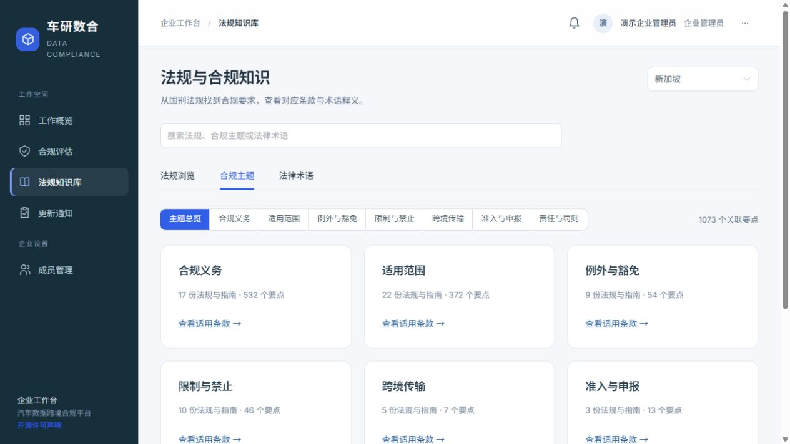
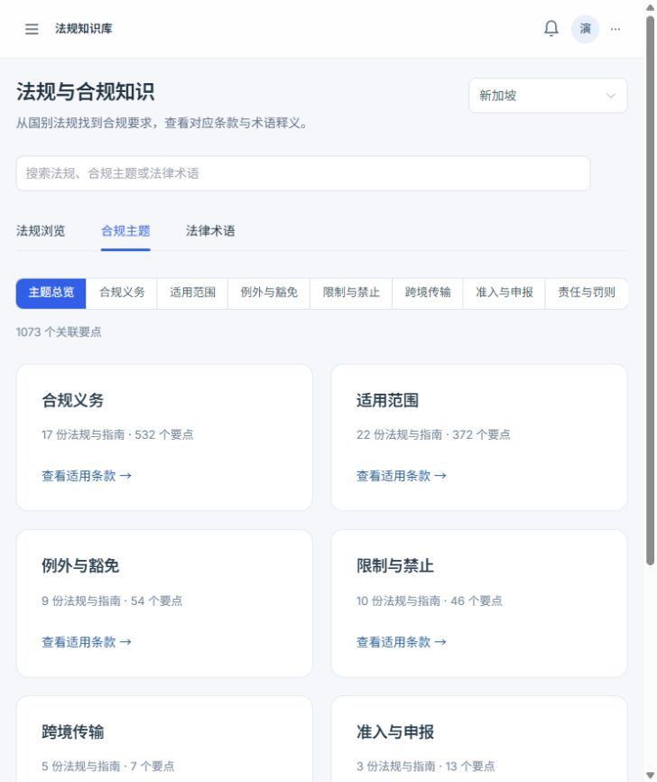
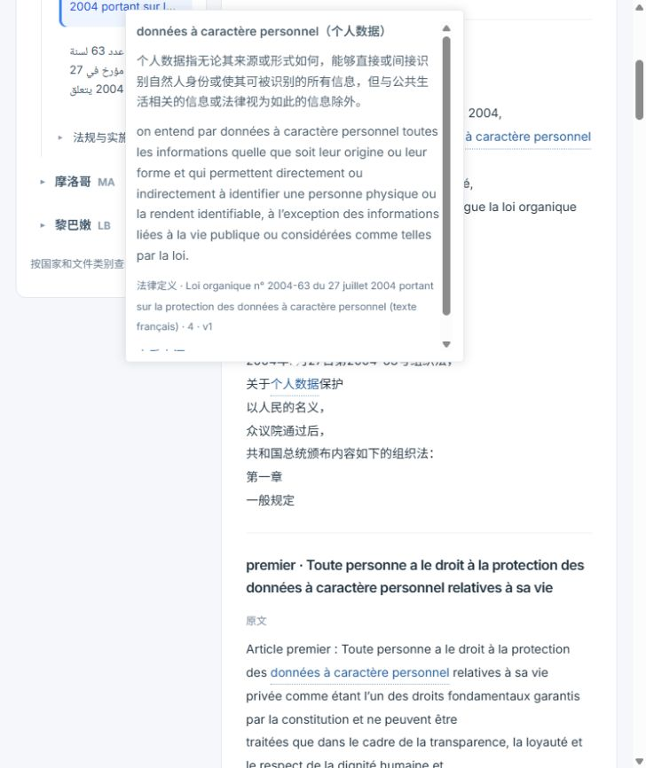

# 用户知识入口与来源术语库交付记录

日期：2026-10-26。分支：`codex/user-experience-legal-terms`。

## 本轮结果

- 用户端采用“国家 → 法规目录 / 合规主题 / 法律术语”的研究入口。主题卡片打开相应文件并定位条款；原文支持服务端分页、全文检索和版本切换，修复旧接口只返回前 80 条的问题。
- 用户报告保留业务事实、八维分析、建议、依据与版本；移除重复提示和模型、工具、工作流实现参数。管理员保留图谱、完整轨迹、配置和审计。
- 新增来源定义表，按照法律定义、监管解释、明确绑定的官方语种对照、国际参考分级。通用概念复用译名及别名，各法域定义和局部适用范围分别保存。
- 翻译注入实际来源定义及规定译名；保留数字、日期、金额、中文完整性和术语检查。硬件语境不误套数据角色；未知对应保留原词与暂译。
- 仅对来源可追溯且影响结论的未解歧义登记解读确认问题，不为常规术语批量建立人工任务。历史人工法律核验状态未变化。

信息组织参考与字段、范围和成本机制见 [架构记录](../architecture/USER_KNOWLEDGE_AND_TERMINOLOGY.md)。

## 数据实测

从生产 0022 备份恢复独立数据库，迁移到 0023。最终规则 `explicit-definition-v5` 识别引号定义、带适用范围的定义及交叉引用式定义；嵌套引号、相邻定义、修订指令均有回归用例。片段始终是原文逐字范围，不补字。

|国家|当前可用来源定义|具备中文释义|
|---|---:|---:|
|新加坡|238|238|
|埃及|13|13|
|突尼斯|12|12|
|摩洛哥|1|1|
|黎巴嫩|13|13|
|合计|277|277|

这是显式定义覆盖量，不是词汇覆盖率或法律准确率。摩洛哥等来源的定义覆盖仍有限；未取得或未识别的定义不会补造。旧全文译文未批量重写，新翻译使用新术语机制。

中文释义初始化及边界修复合计 46 次逻辑调用、47 次实际请求尝试、179,820 已知 tokens。失败批次与修复记录保留。上线采用来源签名匹配的缓存导入，执行同样的来源、术语与数字校验，无需重复付费翻译。

两份独立副本与全新恢复的未修改备份对比：documents、document_versions、clauses、clause_translations、kg_nodes、kg_edges、glossary_terms、review_points、knowledge_audit_records 九张表的行数和整行摘要一致。新定义及释义追加到独立表。重复索引新增 0，重复缓存导入新增 0；没有覆盖来源、图谱、证据和审批记录。

具体记录：[数据校验](user-terminology-data-check.json)、[最终缓存导出](terminology-cache-export-final-20261026.json)、[最终导入演练](terminology-import-final-20261026.json)、[重复导入](terminology-import-final-idempotence-20261026.json)。早期 209 条批次 JSON 为历史执行记录，以最终统计为准。

## 验证

- 后端完整回归：578 项通过；随后来源范围边界与用户展示专项 25 项通过，聊天及 S6 专项 21 项通过。原有反例、权限、RLS、SSE、导出与版本测试仍在。
- 前端：39 项 Node 测试通过；SSE 另有 5 项子检查通过。两端类型检查及生产构建通过，管理端基路径 `/admin/`。
- 真实浏览器：五国目录、主题导航、超过 80 条的原文定位、术语中法对照及官方来源提示、用户报告不展示技术词、管理端完整图谱和工作流轨迹已验证；空白登记表单被拒绝，未写入伪造定义。
- 原始数据与源文件在数据库/归档备份中保留；部署采用增量迁移，回退代码不删除定义表。

## 线上部署

已上线：<https://47.116.46.81/>；管理端：<https://47.116.46.81/admin/>。

运行源码提交 `6f2eeb7`，镜像标签 `6f2eeb7-ip`，数据库迁移 `0023`。两端静态资源路径及实际 JavaScript 内容已检查，API 健康。当前运行角色仍为普通 `cyshuhe_runtime`，无 superuser/BYPASSRLS 权限；原有 11 张 FORCE RLS 表保留。

生产导入新增 275 条中文释义、复用 2 条既有对照，无失败、无来源签名失配、模型调用 0。第二次导入新增 0、复用 277。生产九张受保护表与部署前摘要逐项一致；原文与证据归档未写入。备份位置 `/opt/cyshuhe-backups/20261026T084126Z-pre-terminology`，旧 release 和镜像保留，代码回退不删新表。

真实线上浏览器已验证：五国目录与主题卡片、突尼斯法语法律定义与中文释义悬浮窗、官方来源链接、用户八维报告不展示 MCP/tokens/智能体实现细节、管理员图谱 1,231 条总关系与当前筛选 1,216 条关系、管理员 v48 执行轨迹。管理员只读配置和权限边界保持原状。本次未重新运行或改写既有分析报告。

记录：[部署与数据校验](terminology-production-deployment-20261026.json)、[上线前备份](terminology-production-backup-20261026.json)。

