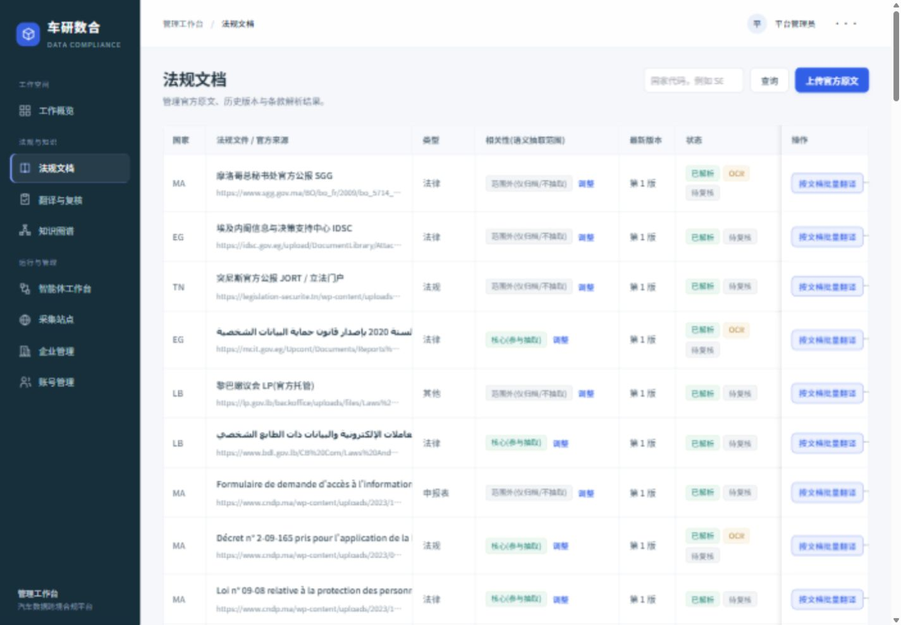
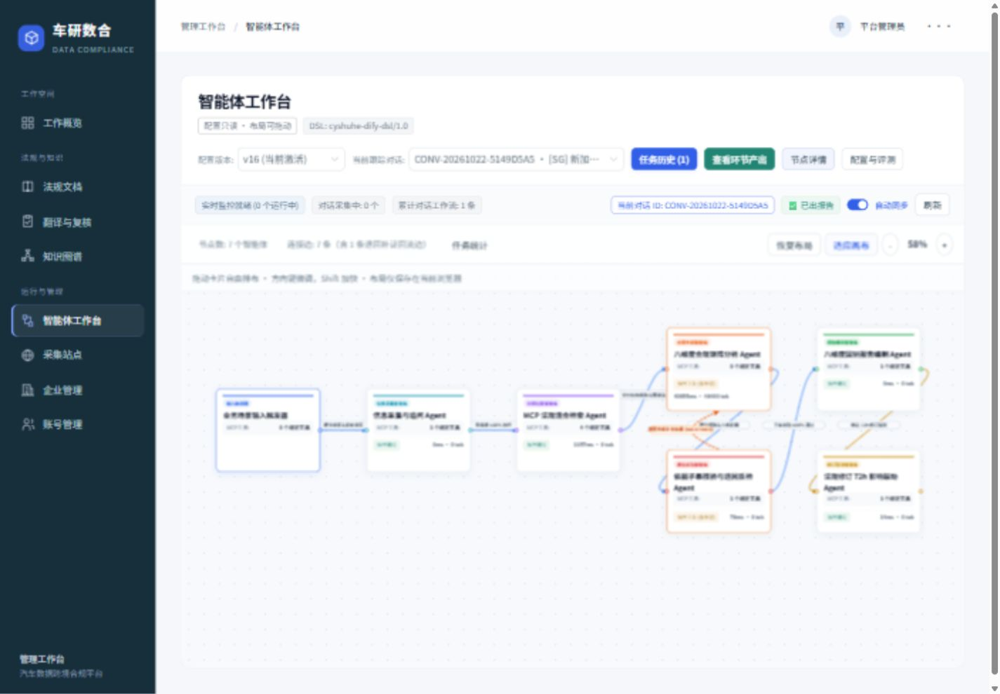

# 法规状态标签与工作台自由布局

2026-10-23，基于 UI 重构提交 `86519d9` 继续修正。

## 改动

- 法规文档的状态标签使用可换行的 flex 容器，标签横向、纵向均保留 6px 间距，取消单独的左边距，行高随内容自然撑开。
- 智能体默认布局按原配置的横向顺序分列，使用实际卡片高度计算纵向间隔，默认相邻卡片间距至少 96 个画布单位。
- 鼠标按住任意卡片拖动即可调整位置，连线端点跟随节点和实际高度更新。拖动结束不会误打开详情；普通单击仍打开详情。
- 缩放后按缩放比例换算拖动距离，并考虑画布滚动偏移。画布范围随节点位置扩展，左上边界有保护。
- 聚焦卡片后可用方向键移动 8 个画布单位，Shift + 方向键移动 32 个单位，Enter/空格打开详情，Esc 取消正在进行的拖动。
- “适应画布”调整缩放以查看全图；“恢复布局”清除自定义位置并回到宽松的默认排布。
- 布局存储在当前浏览器 localStorage 中，按账号及工作流版本隔离；刷新后保留，不同步至其他电脑。

位置属于个人展示偏好，不修改服务器工作流 DSL、执行顺序、连接关系、节点参数或生产只读锁。非法或损坏的布局缓存会忽略；浏览器不允许保存时会显示提示。

## 验证结果

- 真实法规列表 80 行状态容器，标签矩形相交数为 0；桌面和窄屏下均保留换行间距。
- 工作台 7 张卡片，默认布局矩形相交数为 0；连线按实际卡片中心/上下端口定位。
- 实际鼠标拖动输入节点：位置从 `(60, 215)` 移至 `(60, 396)`，相关连线随之更新，没有误打开检查器。
- 刷新页面后该节点仍为 `(60, 396)`；Shift + 右方向键再向下微调后为 `(92, 404)`。
- 点击“恢复布局”后恢复 `(60, 215)`；普通单击仍可打开节点详情，适应画布和缩放入口可用。
- 浏览器控制台无错误。没有运行模型、重跑分析任务或写入后台配置。
- `pnpm typecheck`、`pnpm build`、`git diff --check` 通过；原有大分块构建提示仍存在。
- `pnpm exec node --test scripts/test-workflow-layout.mjs`：5 项测试通过，覆盖可变高度布局、不同缩放比例的拖动换算、边界、缓存恢复和损坏缓存。

## 预览

