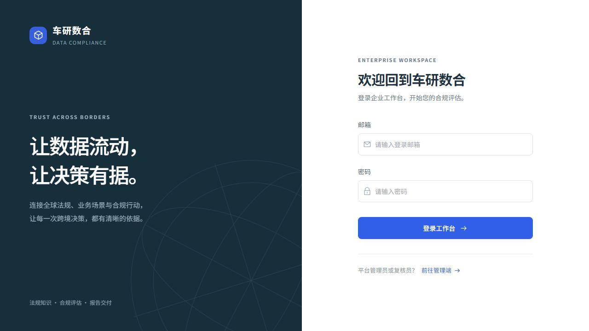
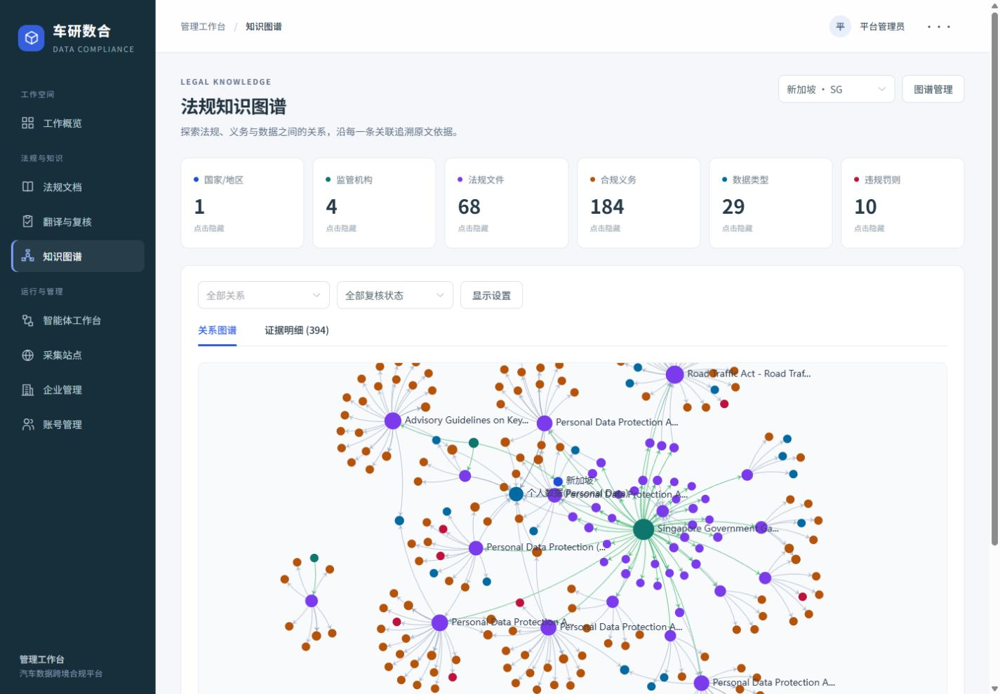
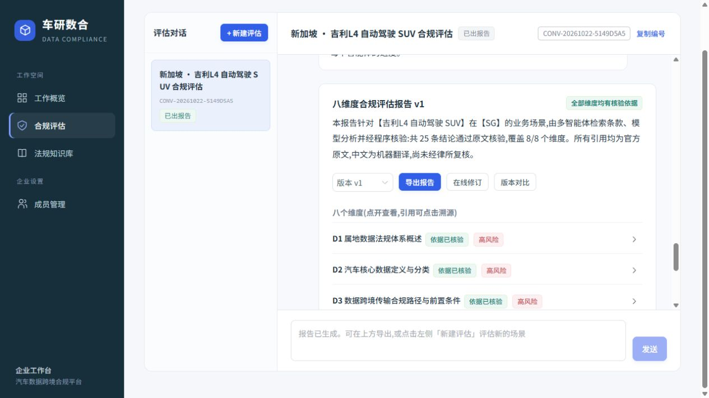
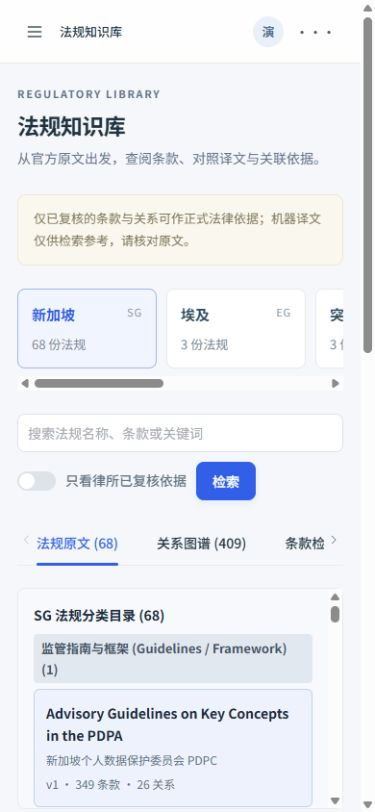

# UI 重构交付记录

日期：2026-10-23。项目：`CrossBorderPlatform`。开发分支：`codex/ui-refresh-20261023`，基于 `86a4b7d`。

后续修复：[法规状态标签与工作台自由布局](FOLLOWUP.md)。

## 范围与边界

重构现有 Vue 管理端和企业端的 14 个页面，以及两端公共布局、图谱组件。保留已有业务操作、权限和 API；没有修改 FastAPI 后端、数据库、迁移、身份认证、路由守卫、模型调用或部署配置。没有新增运行时依赖、外部字体请求或字体文件。此次只交付本地代码，未部署生产环境。

登录提交增加空输入提示和重复提交保护；报告页面调整滚动位置；图谱组件增加隐藏容器尺寸保护。这些属于交互修正。原有报告生成、导出、翻译、复核、采集和工作流业务处理函数保持原逻辑。

## 视觉与交互

- 深色侧栏、浅色背景、白色内容区、蓝色主操作，按工作用途组织导航。
- 页面标题约 23–30px，正文 15px，表格与长文内容以 14px 为主；普通控件 40px、小控件 32px、登录控件 48px。
- 普通操作保持可见；低频配置、批量处理和管理操作放入对应菜单，不删除原操作。
- 统一状态标签、表格、弹窗、抽屉、空状态与焦点提示；待复核和法律依据边界继续明确展示。
- 页面进入和登录插画使用轻量动效，遵循系统 `prefers-reduced-motion` 设置。
- 小屏采用折叠导航、横向国家选择区、纵向知识库阅读布局和自适应抽屉。

公共样式位于 `packages/shared/src/ui/theme.css`，两端 `style.css` 统一引用。图标为本地 SVG，不引入新的图标库。

## 主要操作位置对照

| 页面 | 改动 | 保留的功能与新入口 |
| --- | --- | --- |
| 登录、工作概览 | 统一品牌和大字号表单，首页按任务组织入口 | 使用原账号登录；根据既有角色展示入口 |
| 法规知识图谱 | 合并重复的节点类型开关；关系图与证据表分标签展示 | 六类统计卡片可切换节点；关系、复核状态筛选保持可见；其余筛选在“显示设置” |
| 图谱质量与属性 | 折叠密集质量指标，节点属性按需打开 | 展开“数据质量与覆盖情况”查看完整指标；点击节点打开八项属性与证据；抽取入口在“图谱管理” |
| 法规文档 | 文件名、来源和版本层次更清楚 | 点击文件名进入原抽屉；上传、相关性调整、按文档翻译仍保留 |
| 翻译与复核 | 状态筛选改下拉；减少重复按钮 | “校订与复核”为主操作；快速通过、重译在“更多”；批量翻译和抽取在“批量处理” |
| 智能体工作台 | 默认收起节点详情，突出画布与任务 | 点击节点打开详情；保留任务历史、环节产出、实时监控；配置导入导出和评测在“配置与评测” |
| 采集站点 | 站点操作分层、减少列表噪声 | “运行记录”为主操作；立即运行、条款确认等放入“更多” |
| 企业、账号、成员 | 统一标题、表格、表单和按钮规格 | 原创建表单、角色与启停操作保留 |
| 企业法规知识库 | 压缩国家卡片和长属性区域，优化中外文阅读 | 保留五国切换、法规原文、关系图谱、条款检索和引用溯源 |
| 合规评估 | 调整会话、摘要、八维度和输入区层级 | 打开已有报告优先定位摘要；Word/PDF 合并为“导出报告”菜单；保留在线修订、版本对比与证据抽屉 |

## 实际验证

### 工程检查

| 检查 | 结果 |
| --- | --- |
| `pnpm typecheck` | 两端通过 |
| `pnpm build` | 两端通过；仍有 ECharts/Element Plus 大分块提示 |
| `git diff --check` | 通过 |
| 后端、认证、路由、API 客户端、依赖与锁文件差异检查 | 没有改动 |
| 使用 TypeScript AST 对照改动前后的具名函数 | 业务函数保持原结构；变化集中于图谱展示、节点详情开启、上传标题、登录输入保护和报告滚动 |

### 浏览器检查

在已有本地服务、已有数据和用户提供的四种角色下检查，未新建账号。

| 检查项 | 结果 |
| --- | --- |
| 平台管理员登录与导航 | 通过，8 个业务导航入口 |
| 律所复核员登录与导航 | 通过，5 个入口；访问 `/sites` 按原守卫返回首页 |
| 企业管理员登录与导航 | 通过，包含成员管理 |
| 普通成员登录与导航 | 通过，不显示成员管理；访问 `/members` 按原守卫返回首页 |
| 管理端文档、站点、企业和账号页面 | 已加载真实列表，检查文件详情、上传弹窗与表单；弹窗取消，没有提交数据 |
| 复核页 | 已检查分类标签、状态筛选和校订弹窗；没有提交审批或调用批量模型处理 |
| 新加坡知识图谱 | 显示 6 类节点统计和 394 条证据；隐藏/恢复枢纽节点及关系图/证据表切换正常 |
| 图谱隐藏标签页尺寸变化 | 修复 ECharts 空尺寸报错；回归切换后控制台无新错误 |
| 智能体工作台 | 7 个节点可见；节点详情、任务历史抽屉可打开和关闭 |
| 企业知识库 | 五国选择、法规列表、原文对照和查询入口可用；现有新加坡列表 68 部法规 |
| 已有八维度报告 | 摘要和维度可读；展开维度、打开引用溯源正常 |
| Word、PDF 导出 | 点击两种入口均收到原导出函数的成功提示，未出现浏览器错误；浏览器自动化未确认最终落盘文件，未复核导出文件内容 |
| 390 × 844 小屏 | 企业知识库、折叠菜单和路由切换正常，无页面级横向溢出 |

本轮没有重新运行完整的收费模型分析、采集或批量翻译任务，也没有提交复核、删除、启停或权限变更。因此以上记录验证的是 UI 和现有数据的操作入口，不代表重新验收法律内容、采集覆盖或模型准确率。

## 本地查看与启动

- 管理端：<http://localhost:5174/>，登录页：<http://localhost:5174/login>。
- 企业端：<http://localhost:5173/>，登录页：<http://localhost:5173/login>。
- 在项目根目录分别运行 `pnpm dev:admin` 和 `pnpm dev:user`；后端继续按项目主 README 启动。
- 本次验证使用已运行的开发服务；生产仍使用原部署流程和环境配置。

## 预览

### 登录

### 管理端知识图谱

### 企业报告

### 小屏知识库

## 后续可单独处理

当前构建的大分块提示涉及原有组件库和图表库体积，需单独进行按需加载与打包优化。本次没有通过隐藏警告或替换依赖处理。新生成任务、批量处理与审批写入，建议在隔离测试数据上进一步做业务验收。
